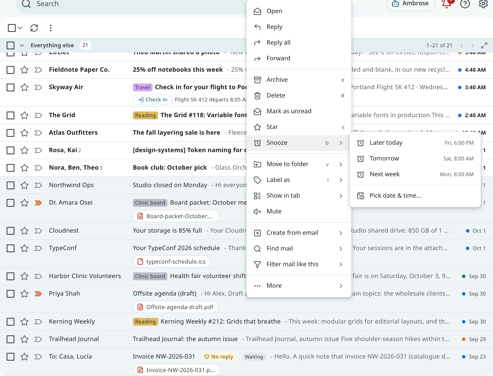
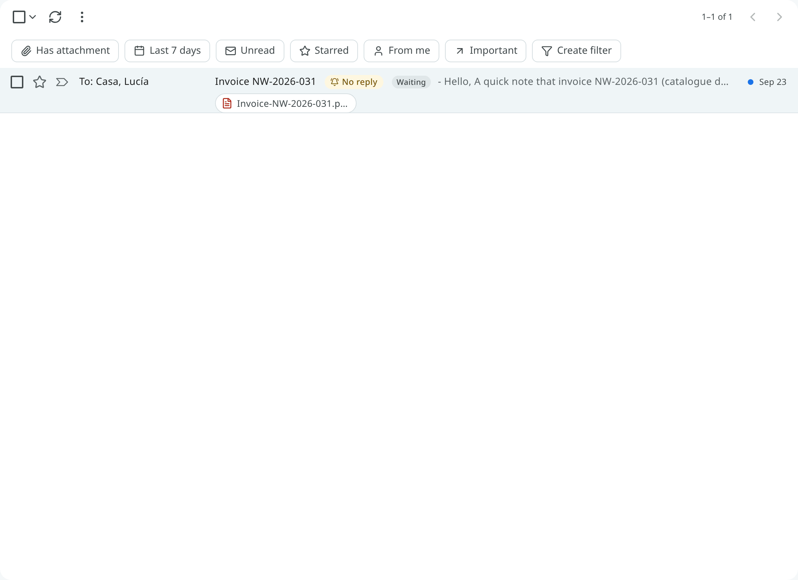
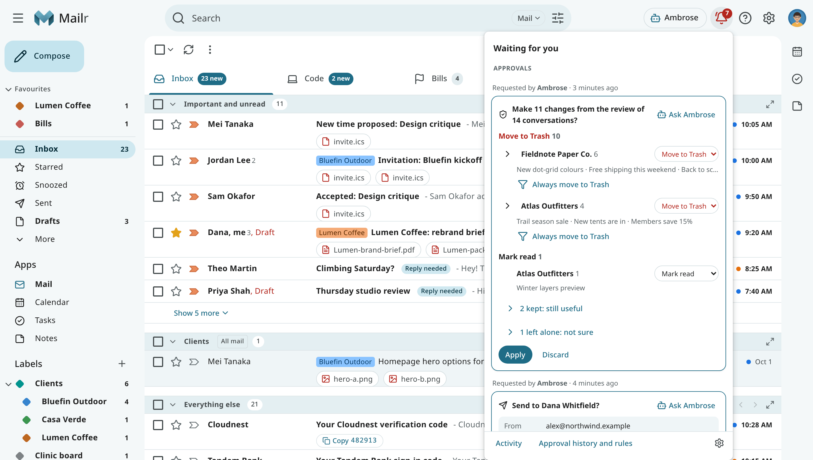
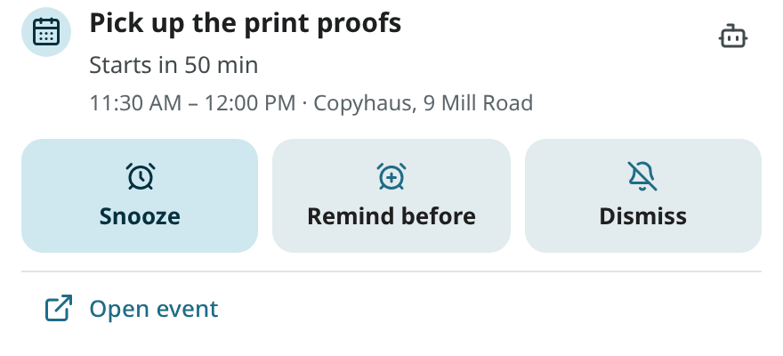
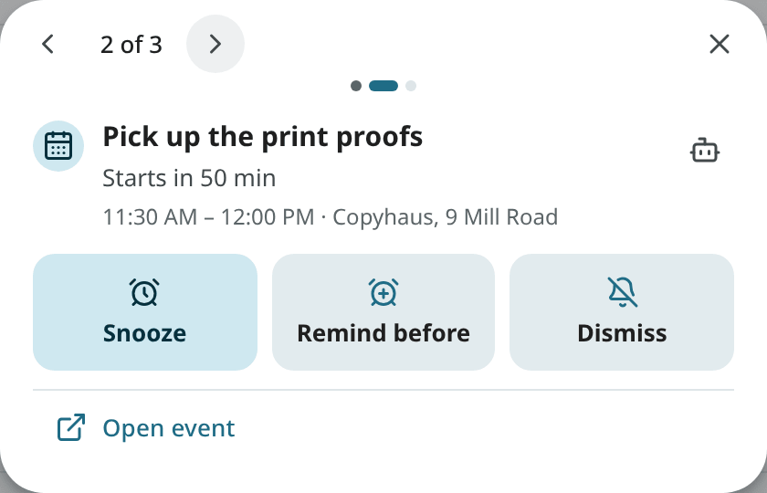
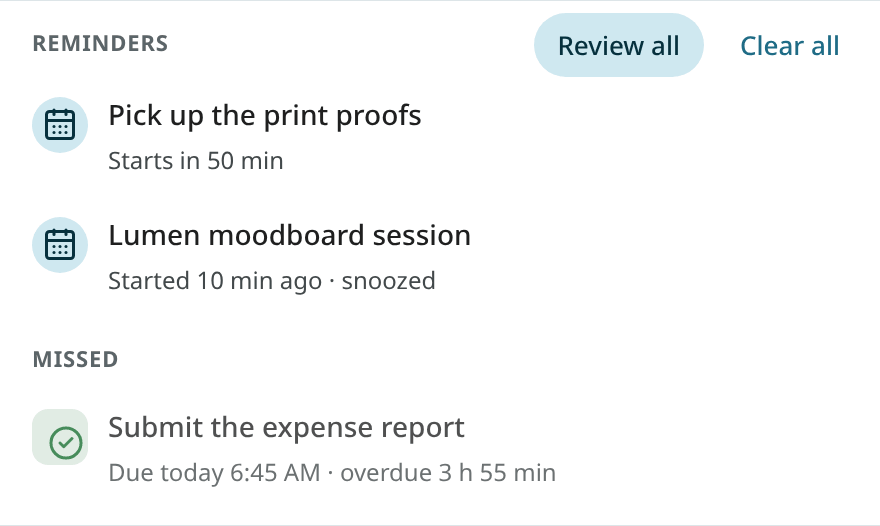

# Snooze, follow-ups and reminders

## Snooze a conversation

A snoozed conversation is taken out of the Inbox until the chosen time, and then returns to the
top as if it had just arrived.

Press `b`, or choose **Snooze** in the toolbar, the reader or the row's menu, and pick a time:

| Choice | When |
|---|---|
| **Later today** | 18:00 (offered until 17:00) |
| **Tomorrow** | Tomorrow at 8:00 |
| **This weekend** | Saturday at 8:00 (offered Monday to Thursday) |
| **Next week** | Monday at 8:00 |
| **Pick date & time** | Any moment you choose |

Snoozed conversations wait in **Snoozed** (`in:snoozed`). Open one and choose **Unsnooze** to bring
it back now. On the phone, snooze from the reader.
<!-- covers: mail.snooze -->

## Follow-ups: remind me if nobody replies

After you write to someone, the conversation can be set to come back if nobody answers.
Choose **Remind me if no reply** in the reader or in the row's menu, and pick **Tomorrow**, **In 2 days**, **In 3 days**, **In a week** (each at 9:00) or a date.

- The reminder is cancelled when someone else replies.
- If nobody replies in time, the conversation returns to the Inbox with a **No reply** chip, and a
  notification is shown, "No reply from Marco". The conversation stays read.
- The chip is removed when someone replies, when you write again, or when you archive, delete or dismiss
  it.

Search with `is:follow_up` for conversations with a reminder set, and `is:nudged` for those that
came back. On the phone, set a follow-up from the reader or the list.
<!-- covers: mail.follow_up -->

## Reminders for events and tasks

Reminders for events and tasks fire when they are due. On the web, a reminder is shown in three ways:

- as a **desktop notification**, while Mailr is open in a tab;
- as a **push notification**, when the browser is open but Mailr is not (if push is turned on);
- under **Reminders** in the bell at the top of every page (**Waiting for you**), with a count of
  what waits. See [Waiting for you](waiting.md).
<!-- covers: reminder.fire -->

A reminder stays until you act on it. When you click a notification or a row in the bell, it is only
opened, not dismissed.

Notes can have reminders too ([Notes: Reminders](notes.md#reminders)). They are shown the same way,
with **Snooze** and **Dismiss**, and open the note when clicked.

### The reminder sheet

Click a notification or a row in the bell to open the reminder's sheet. It shows the event or task with
its actions:

| Action | For | Effect |
|---|---|---|
| **Done** | Tasks | The task is completed. |
| **Snooze** | Tasks | The reminder comes back later: In 10 min, In 1 hour, In 3 hours, This evening, Tomorrow, Next week, or a time you pick. The task's due date does not change. |
| **Reschedule** | Tasks and events | The task's due date, or the event itself, is moved. |
| **Snooze** | Events | Remind me again: In 5 min, In 10 min, At start time, or a time you pick. |
| **Remind before** | Events | This reminder ends and a new one is set: at the start, or 5, 10, 15 or 30 minutes, 1 or 2 hours, or 1 or 2 days before. Only offsets still in the future are offered. |
| **Dismiss** | Both | The reminder is closed. The event or task does not change. |
| **Ask Ambrose** | Both | Ask Ambrose about the item. |

After every action, **Undo** is shown for a few seconds.
<!-- covers: notification.open task.snooze event.snooze event.remind_before reminder.dismiss -->

### Review several at once

When more than three reminders fire together, one notification is shown, "4 reminders". Click
it, or **Review all** in the bell, to open the triage queue: missed reminders first, then the others,
oldest first. Act on each one or step past it with the arrows; whatever you leave stays in the
bell.
<!-- covers: notification.open_stack -->

### Clear all

Use **Clear all** on the bell's Reminders section to dismiss every reminder listed there, missed ones
included. It is shown only when reminders are waiting. With one **Undo**, they all come back. Like a
dismiss, **Clear all** applies on every device: the phone's notifications for those reminders are removed too.
A reminder you snoozed to a later time is not in the bell, so it is left alone. On the phone, you can
do the same with the notification shade's own **Clear all**, or with a swipe on the group of reminders.
<!-- covers: reminder.dismiss_all -->

### Missed reminders

A reminder that fired while your computer was off or asleep appears under **Missed** in the bell.
One quiet notice is shown for them instead of a burst of notifications.

### Reminders on several devices

When you act on a reminder on one device, it disappears from every other device: the browser
notification is closed, the bell is updated and the phone's notification is removed. A device that
was offline is brought up to date the next time it connects.
<!-- covers: reminder.sync -->

### Remind again

With **Remind again** in Settings → Notifications (`reminders.repeat`, off by default), a reminder
nobody acted on is repeated every 5, 10, 15 or 30 minutes, at most 3 times. Each repeat takes the
place of the first notification; no new one is added. No more repeats are sent once you act on the
reminder on any device. Event reminders are repeated only until 15 minutes after the start, and
missed reminders are never repeated. The
phone has its own **Remind again** switch.
<!-- covers: reminder.repeat -->

## Reminder defaults

Reminder defaults are in **Settings → Calendar & tasks**:

| Setting | Default |
|---|---|
| `reminders.default_timed_event` | 10 minutes before an event that has no reminder of its own. |
| `reminders.default_all_day_event` | None for all-day events. |
| `reminders.default_task` | For a task without a reminder, at its due time. |
| `reminders.morning_hour` | Date-only reminders fire at 9:00. |

Which kinds of reminders are delivered (`reminders.events`, `reminders.tasks`, `reminders.missed`) and
how (`reminders.web`, `reminders.sound`) are set in [Notifications](notifications.md).
