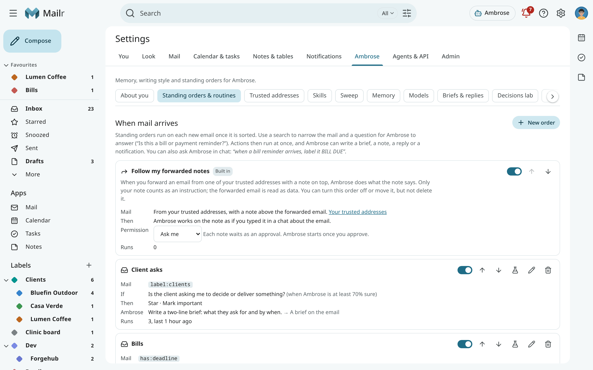
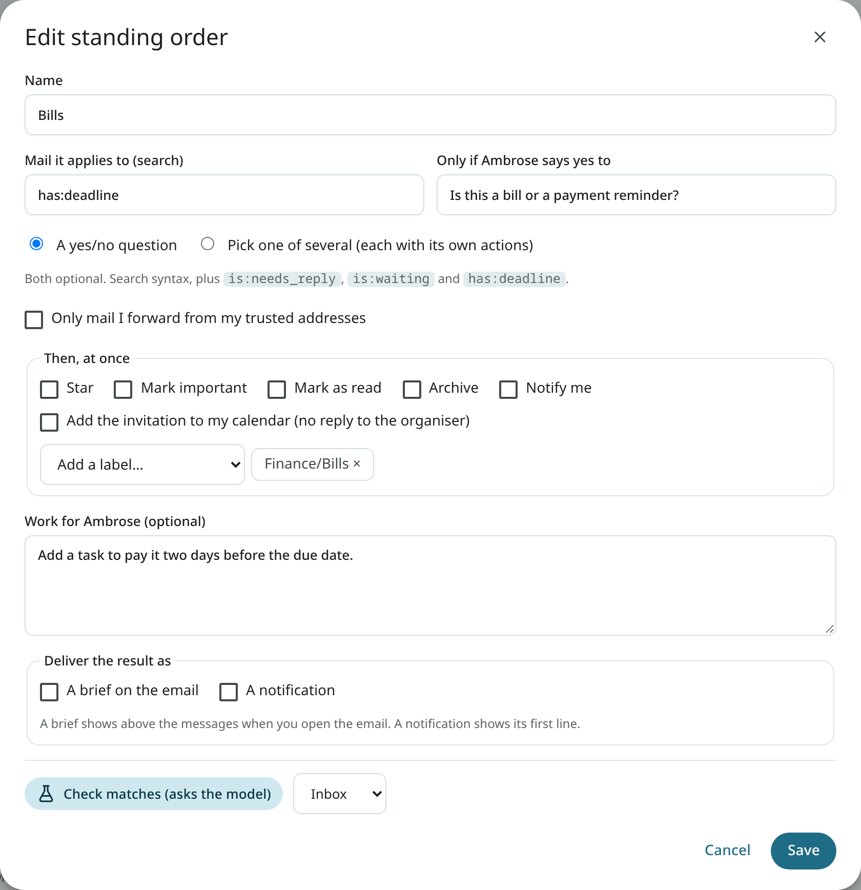
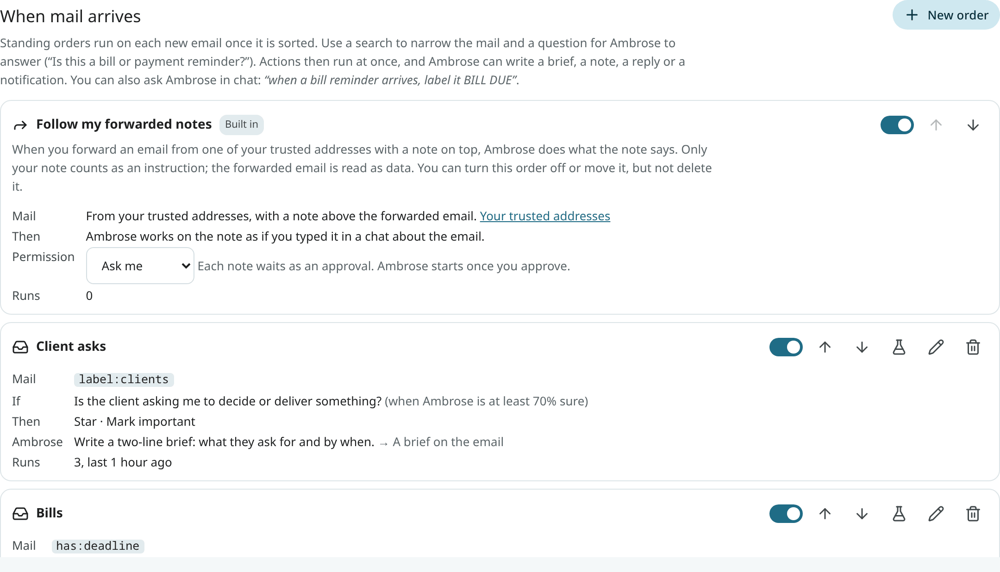
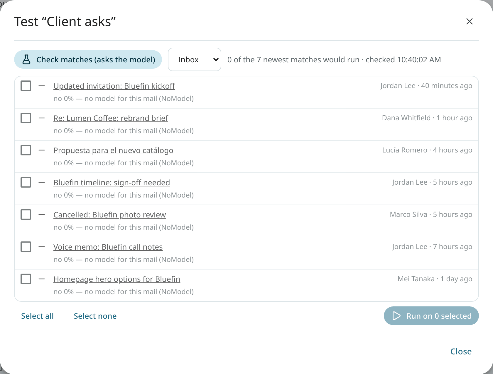
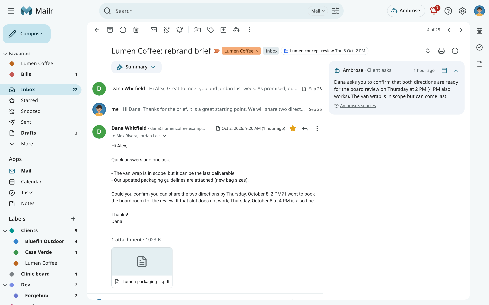

---
search:
  boost: 2
---

# Standing orders and briefs

A **standing order** is an instruction to Ambrose for when certain mail arrives: "When a bill reminder arrives, label it Bills and tell me the due date." A **routine** is run on a schedule: "Every weekday at 8:00, list what needs a reply." Both are run in the background, with the same permissions and approvals as a chat.

Mail is never sent from a standing order or a routine. A draft that Ambrose prepares waits on an approval card, and once it is approved and saved, you send it yourself. To forward matching mail automatically, use a [filter](organize.md#filters) with **Forward it to:** instead.

Open **Settings → Ambrose → Standing orders & routines**.

## Create an order

1. Click **New order** (or **New routine**, or **New recording order** when you have a Speakr account).
2. Give it a name.
3. Narrow the mail with a **search**, using the usual [search operators](../reference/search-operators.md), for example `from:billing@ is:unread` or `is:needs_reply newer_than:1d`.
4. To act only on mail you forward from your work address or another [trusted address](forwarded-notes.md), tick **Only mail I forward from my trusted addresses**. Mail that fails its domain check never matches.
   When the search matches on a recipient address (`to:`, `cc:`, `deliveredto:`), **Only from me or my trusted addresses** also appears in the editor: with it, the order is run only on mail from one of your own addresses or a confirmed trusted address, verified by its domain. See [Orders on an address of yours](#orders-on-an-address-of-yours).
5. Optionally add a **question** in plain English, such as "Is this a bill or payment reminder?". The decision model is asked this question for each message that matches the search. The order is run only when the answer is yes with enough confidence. The list shows the threshold in words: "(when Ambrose is at least 70% sure)".
6. Choose the **instant actions**: add labels, **Star**, **Mark important**, **Mark as read**, **Archive**, set a category, **Notify me**, or **Add the invitation to my calendar** (the event is added as accepted, with no reply to the organiser; whether Ambrose asks first depends on the permission **Create events**).
7. Optionally give Ambrose **work to do**, for example "Summarise the amount and the due date." Then choose where the result goes: **A brief on the email** or a notification.
8. Save.

You can also ask in the chat: *"When a bill reminder arrives, label it Bills."* Ambrose drafts the order and shows it on an approval card. Nothing is saved until it is approved.

<!-- covers: order.create -->

Instead of a yes/no question, the model can be asked in an order to **pick one of several options** ("Which project is this about?"). Each option has a short description and its own actions. The model picks one, or none, and only that option's actions are run.

### Routines

A routine is run on a schedule in your time zone: every morning, every Friday, or a custom schedule. The list shows a custom schedule in words, such as "Weekdays at 8:00" or "Monday and Thursday at 9:00", with the raw schedule in the tooltip. Ambrose reads the mail its search matches. With a Speakr account, Ambrose can also read today's meeting recordings in a routine. The result is delivered as a notification and under **Activity**.

With **Add today's meetings to digests** on (under **Routines**), a routine's digest ends with today's remaining meetings that have guests, each with a link to its [meeting prep](calendar.md#meeting-prep). The setting is `meeting_prep_digest`; it is off by default.

A routine can also review a whole list and propose what to clear out, for example "every Sunday, review my promotions". Its review card waits in the approvals; nothing is moved before you apply it. See [Clean up a whole view](assistant.md#clean-up-a-whole-view).

While the [Screener](screener.md) is on, a routine's digest also shows how many first-time senders wait in it, with a **review** link.

### Recording orders

A recording order is run once on each new Speakr recording after it is transcribed. Recordings are narrowed with a filter on words in the title or participants, a tag or a participant. With a question, Ambrose judges from the summary ("Is this a client meeting?"). Ambrose can then draft the follow-up, propose tasks or link the recording to its meeting. See [Recordings](recordings.md).

## Follow my forwarded notes

Every account has one built-in order at the top of the list: **Follow my forwarded notes**. When you forward an email from one of your [trusted addresses](forwarded-notes.md) with a note on top, Ambrose does what the note says. Only your note counts as an instruction; the forwarded email is read as data.

- **Mail**: from your trusted addresses, with a note above the forwarded email. The checks are those under [Checks on a forward](forwarded-notes.md#checks-on-a-forward).
- **Permission**: with **Ask me** (the default), each note requires approval; with **Allow**, the order starts at once. Each step still follows its own permission, and sending mail always requires approval. Only a permission rule that names forwarded notes (`agent.forwarded_instructions`) gives **Allow**: a wildcard rule such as `*` or `agent.*` does not, and a broad **Deny** rule still stops the order.
- **Off**: turn the order's switch off. Forwarded notes are then ordinary mail.

It can be moved like any order but cannot be edited or deleted. Ambrose cannot change it either, only pause or resume it after approval.

<!-- covers: order.permission -->

## Several matching orders

Orders are run from the top of the list. Use the arrows on an order to move it up or down. The order at the top is run first.

<!-- covers: order.move -->

An action that an order above has already taken for the same email is not repeated:

- **Notify me**: one notification is sent per email.
- **Add the invitation to my calendar**: the invitation is added once, by its ID. It is also skipped when the event is already in your calendar, or when an approval to add it is waiting.
- When Ambrose creates, as work for an order, the event an email invites you to, the event is also given the invitation's ID, so it is not added twice.

Under **Activity**, the skipped action says which order already did it, for example "add to calendar skipped: Work invites already did it". Labels, stars and the other instant actions are the same however often they run.

## Orders on an address of yours

An order can match on a recipient address, for example an alias such as `to:memory@example.com`. Anyone who knows the address can send mail there. When such an order writes (it adds invitations to your calendar, or gives Ambrose work that may save memories, tasks or drafts) and has no condition on the sender, the editor shows a warning with one button: **Only from me or my trusted addresses**. Click it to add that condition.

Existing orders are unchanged. The condition is off by default.

If another assistant program is already set up on that address, list the address under [Addresses for other assistants](forwarded-notes.md#addresses-for-other-assistants). Mail sent only to that address is then left alone by Mailr's orders, unless an order names the address in its search.

## Test an order

Click **Test and run on recent mail** on an order. The newest conversations its search matches are listed, with whether the order would run on each one and the answer to the question with its confidence. Nothing is changed by a test. Tick conversations and run the order on them when the result looks right.

<!-- covers: order.test -->

## Run, pause, edit and delete

- Use **Run now** to run a routine at once. On a recording order, it is run on the newest matching recording. <!-- covers: order.run -->
- Use the switch on each order to pause or resume it. A paused order keeps its settings and is not run. <!-- covers: order.pause -->
- In the Android app, **Settings → Ambrose → Standing orders** lists your orders with their switches, and the permission of **Follow my forwarded notes**. Create, edit and move orders on the web.
- Use **Edit** to open the editor again. Ambrose can also change an order on request, after approval. <!-- covers: order.edit -->
- Use **Delete** to remove the order after you confirm. <!-- covers: order.delete -->

## Activity

**Activity**, at the bottom of the page, lists every run: what triggered it, the answer to the question and how sure it was, the instant actions, and what Ambrose wrote. Open a run to see every step Ambrose took. **Why this is here** in the reader also lists the orders that were run on the message.

One order cannot set off another, and an order is never run again on its own changes. The number of background errands per hour is also limited.

When one order fails, for example because the model could not be reached, its run is listed as failed with the reason, and the other orders are still run on the message. An errand that was interrupted by a server restart after it had already changed something, such as adding an event, is not started again, so nothing is done twice. Its run is listed as failed with that reason; open it to see the steps that were taken.

## Briefs

When the result of an order is **a brief on the email**, Ambrose's report appears as a card on that conversation, with the order's name. Briefs have citations like chat answers.

The text of a brief is written when the order finishes. When the order asked for approvals, each one is listed under the text with its current state, for example **Waiting for your approval** (a link to the card) or **Approved: Draft saved**, so a decision made after the order finished is shown on the card.

<!-- covers: brief.read -->

In a long thread, a brief above the messages starts folded into one strip with the summary, showing its first line. Click it to open it. See [The summary card](reading.md#the-summary-card).

Briefs can be placed **above the messages** or **beside the messages**. Use the dock button on the card, or **Settings → Ambrose → Briefs & replies**. Beside the messages, the brief stays in view while you scroll. The setting is `brief_position`.

<!-- covers: brief.dock -->

To change a brief, ask Ambrose with the conversation open: "Make the brief shorter" or "Translate the brief into Spanish." It rewrites the card and keeps the original. Ask it to restore the original text at any time.

<!-- covers: brief.rewrite brief.restore -->

Briefs are also shown in the Android app's reader.
