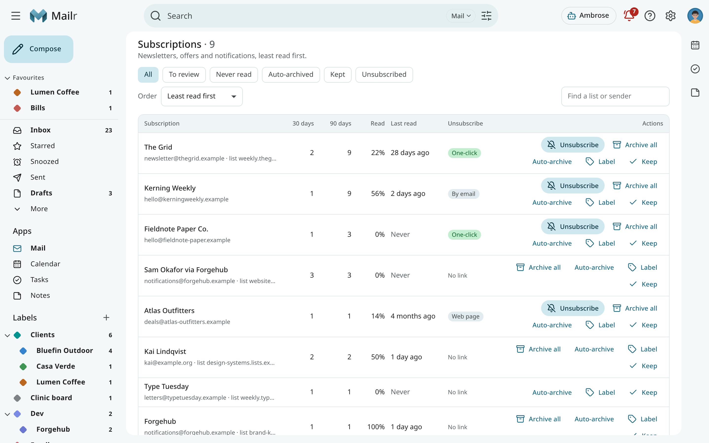
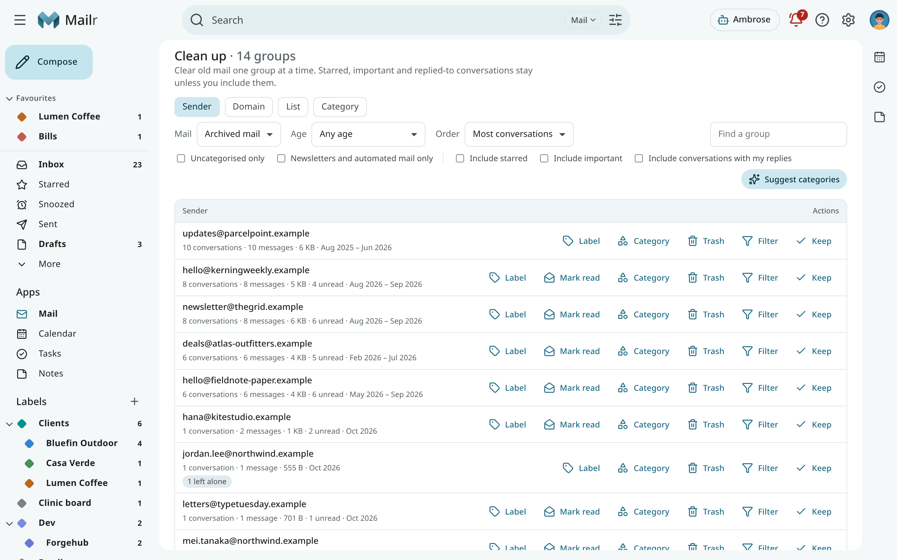
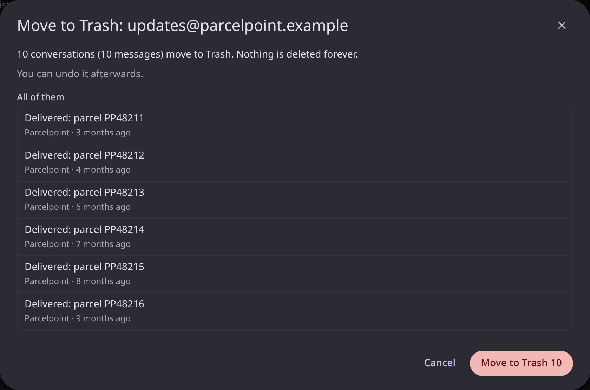

# Subscriptions and cleanup

Two pages under **Mail** are for mail you did not write and rarely read: newsletters, offers,
notifications and years of old archived mail. Both are in the navigation (under **More** in the
Classic style) and look the same in every style and on a phone.

## Subscriptions

**Mail → Subscriptions** lists every mailing list and every sender of bulk mail, one row each.
Mail with a list header is grouped by its list; other mail that has an unsubscribe link is
grouped by the sender's address.
<!-- covers: subscription.list -->

Each row shows:

- how many messages arrived in the **last 30 days**, the **last 90 days** and in all;
- the share you **read**, and when you **last read** one;
- whether you ever **replied** in one of its conversations;
- how it **unsubscribes**: **One-click**, **By email**, **Web page**, or not at all. **Checking**
  means the newest message is still being looked at; the row is updated automatically.

In the first order, **Least read first**, busy subscriptions you never open are at the top. Change
the order, or show only the subscriptions **To review**, **Never read**, **Auto-archived**,
**Kept** or **Unsubscribed**. Use the search box to find a list or a sender.

### Subscription actions

- **Unsubscribe.** A dialog first shows what will happen. For **One-click**, a single
  unsubscribe request is sent to the list's own address; the page is never opened. For **By email**,
  a message with the subject and text "unsubscribe" is sent to the list's address, from the address
  that received the list, and only when that address belongs to the sender's or the list's
  domain. For **Web page**, you open the page yourself. When the administrator requires the VPN
  egress for remote content, a one-click request waits for it too.
  <!-- covers: subscription.unsubscribe -->
- **Archive all.** The subscription's conversations in the Inbox are taken out of it. They are
  listed in a preview first, and the toast has **Undo**.
  <!-- covers: subscription.archive_all -->
- **Auto-archive.** New mail from the subscription is kept out of the Inbox. A filter is made for
  this in Settings → Mail → Filters & blocking; use **Stop auto-archive** to remove it.
  <!-- covers: subscription.auto_archive -->
- **Label.** Put one of your labels on all of its conversations, with a preview and **Undo**.
  <!-- covers: subscription.label -->
- **Keep.** Mark it reviewed, so it is removed from **To review**. Use **Review again** to bring it back.
  <!-- covers: subscription.keep -->

With Archive all and Label, starred and important conversations, and conversations you replied
to, are left alone; the preview has switches to include them.

## Clean up

On **Mail → Clean up**, a backlog is grouped so that it can be cleared one group at a time. Group the mail by
**Sender**, **Domain**, **List** or **Category**, and choose which mail to look at:
<!-- covers: cleanup.groups -->

- **Mail**: archived mail (not in the Inbox, Trash or Spam), the Inbox, or all mail;
- **Age**: any age, or older than a month up to five years;
- **Uncategorised only**, and **Newsletters and automated mail only**.

Each group shows its conversations, messages, size, unread count and dates, and how many
conversations it **leaves alone**.

### Safeguards

- **Starred** and **important** conversations, and conversations with **your own replies**, are
  never touched unless you tick **Include starred**, **Include important** or **Include
  conversations with my replies** (on the page or in the preview).
- Before every action, a **preview** is shown: the exact number of conversations and messages,
  the newest 20 of them (click one to open it), what is left alone and why, and whether the action
  can be undone. Nothing changes until you confirm.
- If the group changes between the preview and your click, for example because new mail arrived,
  the action is stopped and you are asked to look again.
- Use **Trash** to move conversations to Trash. Nothing is ever deleted forever from this page.
- Mail from local-only accounts follows the same rules as everywhere else: it is never sent to a
  hosted model.

### Actions on a group

| Action | Effect |
|---|---|
| **Archive** | Take the group's conversations out of the Inbox (shown when some are there). <!-- covers: cleanup.archive --> |
| **Label** | Put one of your labels on them. <!-- covers: cleanup.label --> |
| **Mark read** | Mark them read. <!-- covers: cleanup.read --> |
| **Category** | Move them to an inbox category, such as Promotions or Updates. <!-- covers: cleanup.category --> |
| **Trash** | Move them to Trash. <!-- covers: cleanup.trash --> |
| **Filter** | Make a filter for the group's future mail: skip the Inbox, mark read, a label or a category. Mail you already have stays as it is. <!-- covers: cleanup.rule --> |
| **Keep** | Mark the group reviewed and change nothing else. <!-- covers: cleanup.keep --> |

Small groups are changed at once. Large ones are processed in the background, with a progress
message. Either way the message at the end has **Undo**. Above 10,000 conversations there
is no Undo, and the preview shows this.

### Category suggestions

For uncategorised mail, use **Suggest categories** to ask the sorting model for a category for
each group, from a few of its messages. Only the model your account may use is asked, and mail from
local-only accounts is sent to a local model only. Choose **Tonight** (between 1 and 6 in the morning,
your time) or **Start now**.
<!-- covers: cleanup.suggest -->

A suggestion is shown on the group as **Promotions? Apply**, for example. Nothing changes until
it is applied, and with **Apply** the same preview is shown as with **Category**.

## Cleanup through Ambrose

Ambrose can list the subscriptions and the cleanup groups, and propose a cleanup. Every proposal
requires approval: the approval shows the number of conversations, what is left alone and sample
subjects, and nothing changes before it is approved. The same applies to an
unsubscribe through Ambrose. See [Approvals](approvals.md).
<!-- covers: cleanup.plan -->

To have Ambrose go through every conversation of the list on your screen and propose moves sender
by sender, type `/sweep` in the chat. See [Clean up a whole view](assistant.md#clean-up-a-whole-view).
