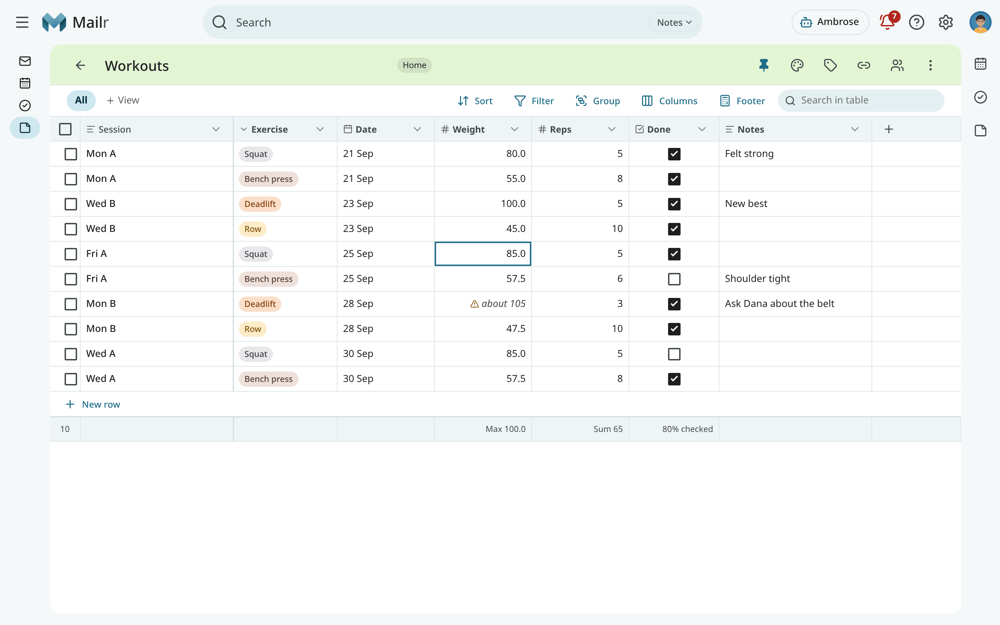
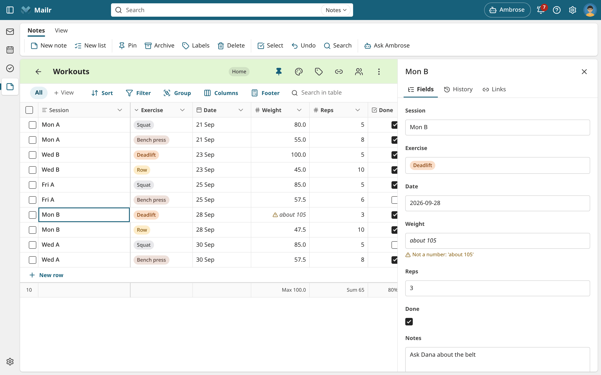
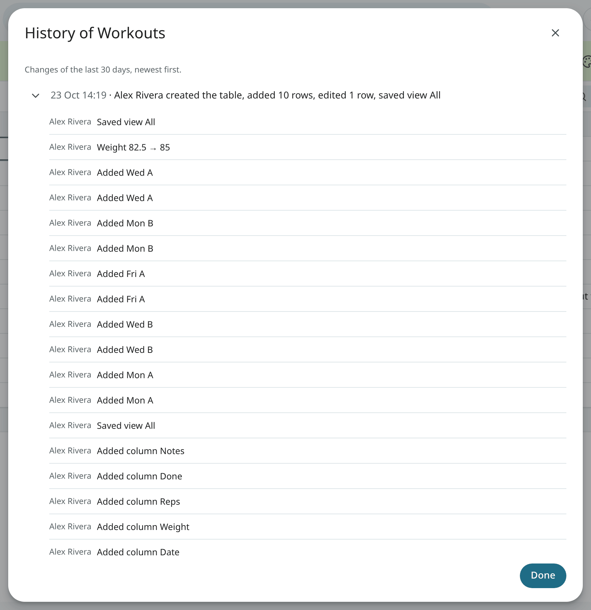
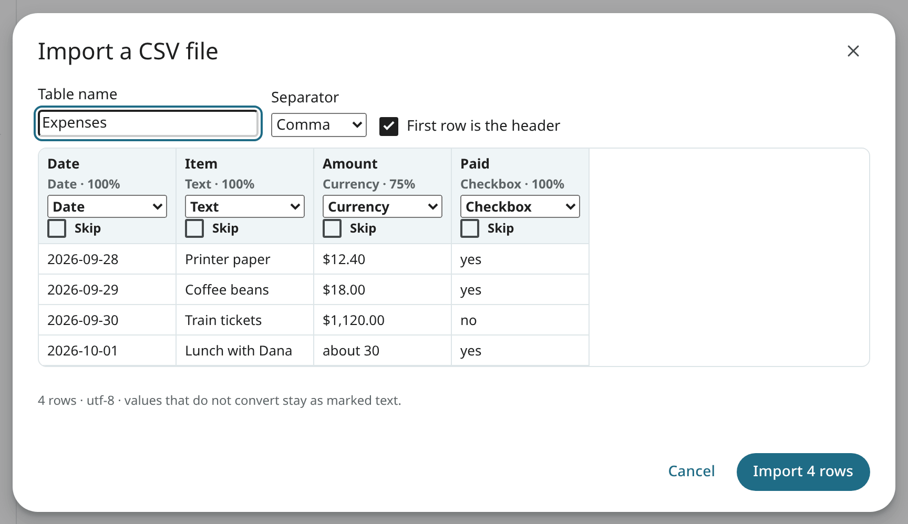
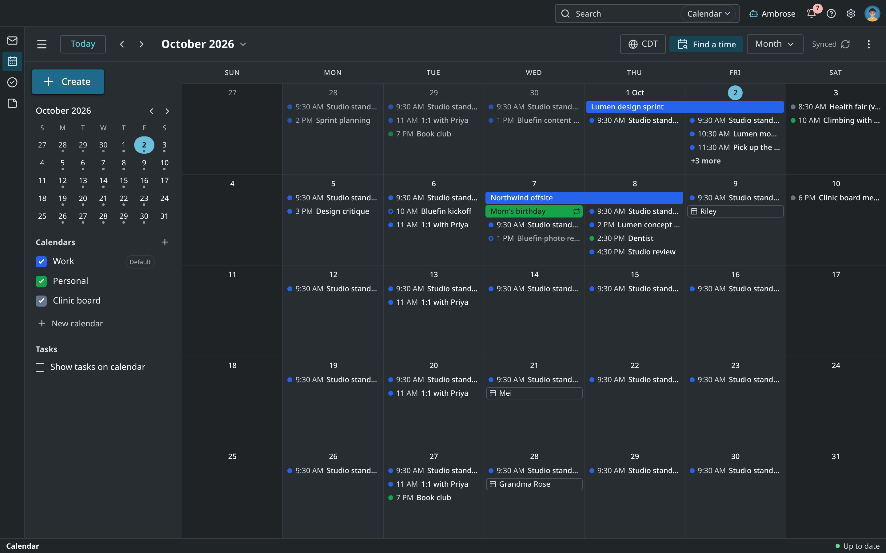
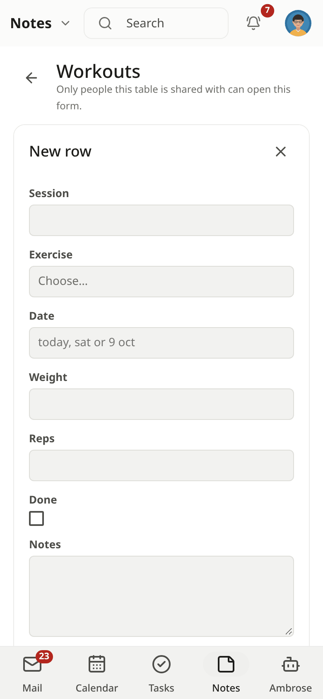
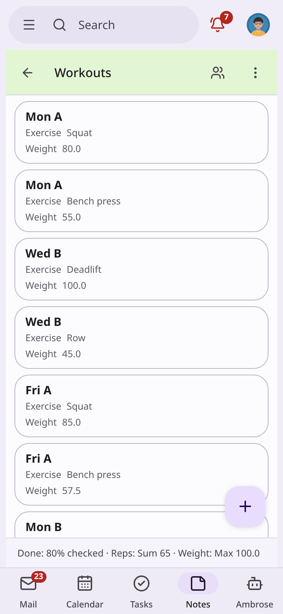

# Tables

A table is a small typed list in the Notes app, such as a workout log, a filament inventory or an
expense log. Each column has a type, and every cell is checked against its column. A
table holds up to 50 columns and 10,000 rows. Larger data belongs in a spreadsheet.

=== "Web"

    In Notes, click **Tables** in the left column, or press `g` then `b`. Tables are also listed in the
    **Notes** view and in label views, next to your notes, in the same order. Click a table's card
    to open it.

## Make a table

<!-- covers: table.create table.import_csv -->

- Click the table button in the bar above the grid (**New table**). Give the table a name and its
  columns: a name and a type for each. **Log** and **Inventory** are starting sets of common columns.
  Without changes, the table has one text column, **Name**.
- In the command palette (`Ctrl + K`), type **New table: Workouts**.
- Use **New from template** above the grid to start a table from a template: the **Expenses** starter, or
  a table you saved as a template ([Notes: Templates](notes.md#templates)).
- Use **Import CSV** in the same dialog to make a table from a CSV file (see below).

## Column types

| Type | A cell holds | Input |
|---|---|---|
| Text | Any text, up to 10,000 characters. With **Long text**, a box is shown | Anything |
| Number | An exact number, with the column's decimals and format | `82.5`, `1,250` |
| Currency | An amount in the column's currency | `$12.40`, `1,120` |
| Date | A day | `today`, `fri`, `12 oct`, `2026-10-12` |
| Date and time | A day and a time | `fri 3pm`, `2026-10-12 14:30` |
| Checkbox | Checked or not | A click, or `Space` |
| Select | One option, shown as a coloured chip | The menu, with a filter line |
| Multi-select | Several options | The same menu, with checkboxes |
| Link | Rows of a table, emails, events, tasks, or notes and tables | A search picker |

A value that does not fit its column is kept as text, with a warning mark. The tooltip shows what
went wrong ("Not a number: 'about 80'"). It is replaced by the next valid value.

A link to something you cannot see is shown as **Not shared with you**. A link to something
deleted is shown as **Deleted**, and comes back if it is restored. The rows that link to a row are listed under
**Links → Linked from** in its form, and those that link to an email, an event or a task on that item.

How a date such as 12/10 is read, and the currency of a new currency column, are set under
**Settings → You → Region**.

## The grid

<!-- covers: row.add row.edit row.delete row.duplicate row.move row.bulk_edit row.bulk_delete -->

The first column holds the name of each row and stays in place when you scroll sideways. Click a cell to focus
it and start typing to change it. Click **+ New row** at the bottom to add a row. In a view
with filters the new row is given their values, so it stays in view. A date column named **Date** is
filled with today.

| Key | Action |
|---|---|
| Arrows | Move the focused cell |
| `Enter`, `F2` | Edit the cell; `Enter` again saves and moves down |
| `Tab`, `Shift + Tab` | Save and move right or left |
| Typing | Start editing with that character |
| `Esc` | Cancel the edit; then clear the selection |
| `Space` | Check a checkbox; open a select menu |
| `Delete`, `Backspace` | Clear the cell, or the selected range |
| `Shift + arrows`, `Shift + click` | Select a range of cells |
| `Ctrl + C`, `Ctrl + V` | Copy and paste a range as tab-separated text. Rows are added when you paste past the last row |
| `Ctrl + D` | Fill the first row of the range down |
| `Shift + Enter` | A new row below |
| `Ctrl + Enter`, `o` | Open the row's form |
| `x` | Select the row |
| `Ctrl + Shift + Backspace` | Delete selected rows |
| `Alt + ↑`, `Alt + ↓` | Move the row, in the manual order |
| `/` | Search in the table |
| `z`, `Ctrl + Z` | Undo |
| `?` | These keys |

Right-click a cell for **Earlier values**, **Copy**, **Paste**, **Clear**, **Insert row above**,
**Insert row below**, **Duplicate row** and **Delete row**. You can also drag a row by its handle
in the manual order.

Every change is followed by a toast with **Undo** for 7 seconds. A paste, an import or a bulk change is undone
as one step. Several edits to one row in a few seconds share one toast, such as "Hotel row changed",
and all of them are put back with its **Undo**.

## The row form

<!-- covers: row.history row.restore_version -->

Press `Ctrl + Enter` or `o`, or tap a row on a phone, to open its form. It appears where
details appear in your style. Each field is saved on its own.

- **Fields**: one per column. Hidden columns are under **Hidden fields**.
- **History**: each change of the row, who made it and when ("Dana · 3 Oct 14:02 · Weight 80 →
  82"). With **Restore row to this point**, the whole row is put back.
- **Earlier values** of one cell: each value with its author and time. With **Use this value**, it is
  put back.
- **Links**: the rows that link here, and the row's own links.

## Columns

<!-- covers: column.add column.rename column.retype column.options column.config column.reorder column.set_primary column.delete column.restore -->

From the ⌄ menu on a column's header you sort, filter, group or hide by that column. The menu also has:

- **Rename**, **Settings** (decimals, number format, currency, long text, required), **Options**
  (add, rename, recolour, reorder, merge or delete the options of a select column).
- **Change type**, with a preview first: "48 cells convert, 3 do not (kept as text)". After an undo, the
  old type and the old values are back. A link column keeps its type.
- **Insert left**, **Insert right**, and **Make primary**: the primary column holds each row's name in
  links, history and on a phone.
- **Delete**, with the number of values and a CSV copy offered first. A deleted column can be
  brought back with its values under ⋮ → **Deleted columns** for 30 days.

Drag a header to move the column; drag its right edge to change the width, or double-click the
edge to fit the content.

## Views

<!-- covers: table.view_edit table.view_save table.view_delete table.search table.stats -->

The bar above the grid holds the views of the table, and **Sort**, **Filter**, **Group**,
**Columns** and **Footer**:

- **Sort** by up to three columns. Empty cells always come last. Without a sort, rows keep the
  order you give them by hand.
- **Filter** with the operators of each type: contains, is, between, in the last 7 days, is any
  of, links to, is empty, and more. All filters must match. Dates such as "today" stay relative.
  The active filters are shown as chips; click × to clear one.
- **Group** by a select, multi-select, checkbox, date (by day, week, month or year) or single link
  column. Each group has its count and footers.
- With **Columns** you hide columns and pick the one or two columns shown under each row on a phone.
- With **Footer** you total a column: sum, average, median, minimum, maximum, count, earliest, latest,
  checked, a count per option, filled, empty or unique.

After a change, **Unsaved changes · Save · Reset** is shown. Use **Save as view** to keep the changes
as a new view. Right-click a view's tab to rename it, make it the default or delete it. Search in the table
(`/`) to find text in any cell.

## History and restoring

<!-- covers: table.history row.restore table.restore_point -->

Under ⋮:

- **History** lists the changes of the last 30 days in sessions ("Today 14:02 · Dana edited 12
  rows"). Open a session to see each change.
- **Deleted rows** lists rows deleted in the last 30 days, with who deleted them and when. Select
  them and click **Restore**.
- With **Restore to a point in time…**, the whole table is put back as it was at a moment of the
  last 30 days. A summary of the changes is shown first: "4 rows come back, 12 rows change, 2 rows are removed".
  The restore is one step in the history and is reverted with one undo. It can also be started from a
  session or a change in History.

## CSV and Excel import and export

<!-- covers: table.export_csv table.export_xlsx -->

With **Import CSV** (in a table's ⋮, or in the New table dialog) you bring in a file or pasted text: UTF-8 or
Latin-1, separated by commas, semicolons or tabs. The preview shows the first 20 rows and the type
found for each column with the share of values that fit ("Number · 98%"). Change a type, or skip a
column. Rows added to an existing table are matched to its columns by name; other columns are added.
Values that do not convert are kept as text with a warning mark. At the end, "Imported 480
rows · 3 cells kept as text" is shown, with **Undo**.

With **Export CSV** you save the current view (its filters, sort and visible columns) or the whole table.
Numbers come without separators, dates in ISO form, and the currency in the header ("Amount
(USD)"). Tick the spreadsheet option to add a byte-order mark (required by some spreadsheet programs).
Text that a spreadsheet would read as a formula (it starts with `=`, `+`, `-` or `@`) gets an
apostrophe in front, so a cell such as `=HYPERLINK(…)` stays text when the file is opened. Negative
numbers are left as they are.

With **Export to Excel (.xlsx)** you save the current view or the whole table as a workbook for
Excel, LibreOffice or Google Sheets. The cells keep their types: numbers and amounts stay numbers
(an amount in its currency's format), dates and times are dates, checkboxes are TRUE or FALSE,
several options are joined with "; ", and links are shown by their titles. Text is always
saved as text, never as a formula. The header row is bold and stays
in place as you scroll. To export the whole table, you can also use the ⋮ menu of a table's card in Notes.

## The table itself

<!-- covers: table.rename table.color table.pin table.label table.archive table.duplicate table.delete table.restore table.purge table.link table.unlink -->

Click the name to rename the table. From the header you also pin the table, set its colour and labels,
and link it to an email, an event, a task or a recording: search for it, or paste its Mailr address.
The table is listed in the links of the email, event, task or recording in turn. ⋮ has **Duplicate**,
**Save as template** (the columns, with no rows), **Archive** and **Delete**. A deleted table stays in Trash for 30 days with its
rows, views and links; a CSV copy is offered first. In Trash, restore it or delete it forever.

## On your calendar

<!-- covers: table.on_calendar -->

The dates of a table with a date column, such as birthdays, bin days or a lending log, can be shown on the calendar.
In the table's ⋮ menu, under **On your calendar**, choose the date column (**Show Day dates**). Each
row with a date is shown on that day as an all-day chip with the row's title, beside your events. Click a
chip to open the row. A date-and-time column is shown by its date. Only your own calendar changes, even on a shared table. Choose **Not on the calendar** to take the dates off.

## The Add-a-row form

<!-- covers: table.form_link -->

Choose **Open the “Add a row” form** or **Copy the “Add a row” link** in the table's ⋮ menu. With
the link, only the row form is opened, for someone in your group to log a row quickly, such as a chore
done, a meter reading or a book lent. The form is never public. Whoever opens the link signs in first, and only
the people the table is shared with at **Edit** can add a row. Anyone else is shown the reason.
After **Save** the form is cleared for the next row.

## Local models only and presence

<!-- covers: table.local_only table.presence -->

**Local models only** in the ⋮ menu works for a table as for a note ([Local models
only](notes.md#local-models-only)). While someone else has a shared table open, the table shows "Dana
is in this table".

## Share a table

<!-- covers: table.share table.unshare table.leave table.move_group -->

Tables are shared as notes are ([Share a note](notes.md#share-a-note)). On the table screen, click
the people button in the header, or choose **Share…** in a table card's ⋮ menu. **Edit** covers
rows, columns and views. Someone at **View** sees "View only · shared by Dana"; they can still sort and
filter for themselves. Only the owner, or for a group's table its maker or an administrator,
can delete the table. Use **Remove from my notes** in the ⋮ menu to take a table someone shared with you
out of your notes, with **Undo**. The row form shows who added and who last changed a row, and "Dana is
editing" while another person writes.

## On a phone

The table is a list of cards: the first column in bold and the phone columns under it. View chips
and filter chips sit at the top, the footers at the bottom. Tap **+** for an empty form; with **Save and
add another** it stays open for logging several rows. Tap a row to open its form full screen.

## Ambrose

Ambrose reads and changes your tables with your own access. Answers cite a table or a row;
click the chip to open the table with that row's form.
