# Tabs and layouts

The Inbox is drawn from a **layout**: optional tabs across the top, and one or more sections inside
each tab. A layout is either a built-in inbox type or a custom layout. The same layout is drawn in the web
app and the Android app.

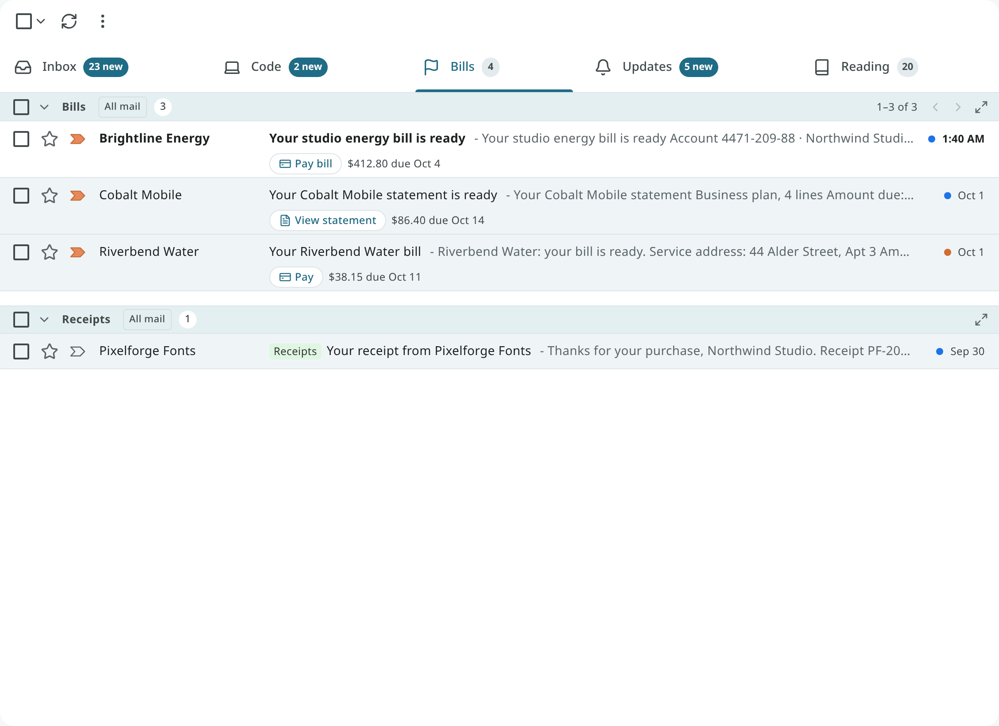

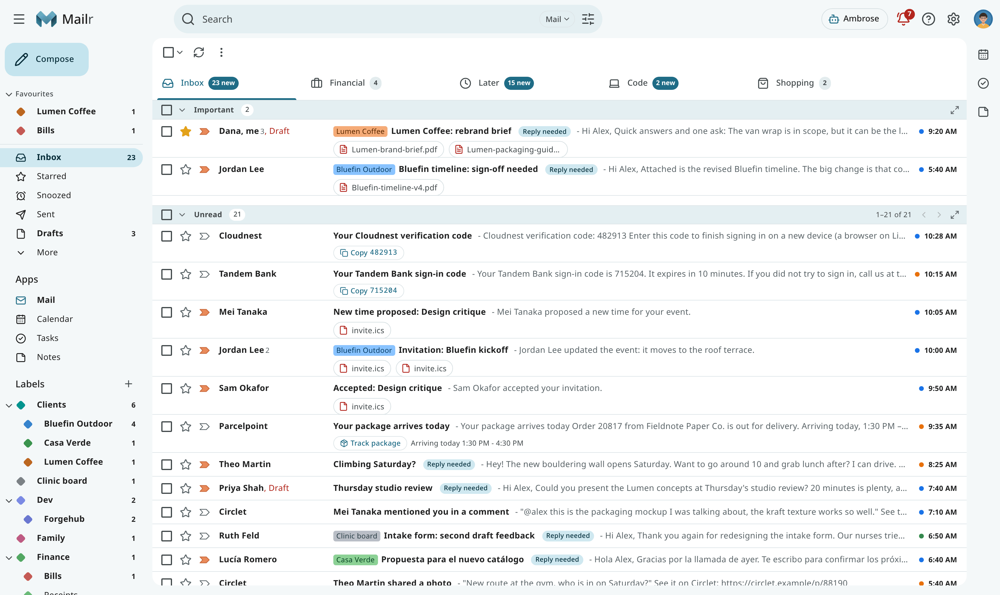

## Built-in inbox types

Choose one under **Settings → Mail → Inbox → Inbox type** (`inbox_type`).

| Type | Contents |
|---|---|
| **Categories** | Newest first, with category tabs. **Categories** (`categories`) lists which categories get a tab: Primary, Promotions, Social, Updates and Forums by default, and Purchases when you tick it. Primary always has one. |
| **Important first** | Important conversations, then everything else. |
| **Unread first** | Unread conversations, then everything else. |
| **Starred first** | Starred conversations, then everything else. |
| **Custom sections** | Sections you choose and order, such as Important and unread, Starred and Everything else (`priority_sections`). |
| **Multiple inboxes** | Extra sections, each a saved search, such as `is:starred` or `label:Clients` (`multiple_inboxes`). |

## Custom layouts

Open **Settings → Mail → Inbox → Your layouts** and choose **New inbox layout**, or start from a built-in
type and change it.

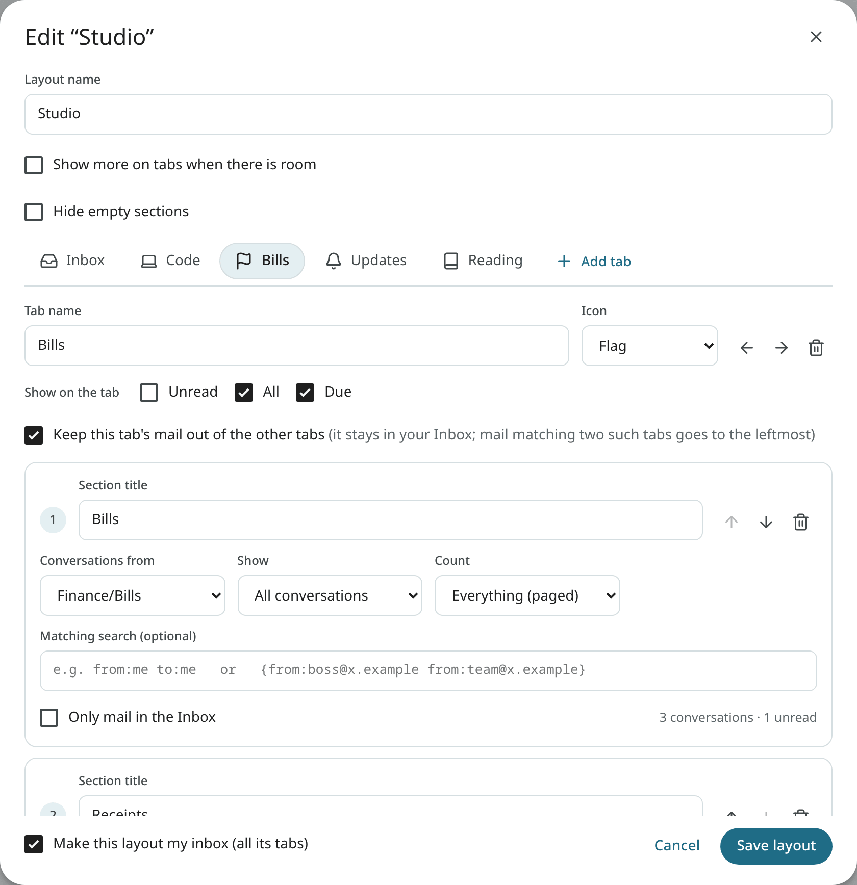

A layout has a name and one or more tabs. With one tab, the inbox has no tab bar. The first
tab is counted in the number by Inbox (see [The Inbox count](#the-inbox-count)). Each tab has:

- a **Tab name** and an **Icon**;
- **Show on the tab**: any of Unread, All and Due (see [Tab indicators](#tab-indicators));
- **Keep this tab's mail out of the other tabs**: its conversations stay in this tab only (see
  [Claiming tabs](#claiming-tabs));
- one or more sections.

Each section has:

| Field | Description |
|---|---|
| **Section title** | The heading above the section. |
| **Conversations from** | Where the section starts: Inbox, All mail, Starred, Important, Snoozed, Sent, Drafts, Archive or a label. With Inbox, a **Category** can also be picked. |
| **Show** | All conversations, Unread, Important, Important and unread, or Starred. |
| **Matching search (optional)** | A search in the [search syntax](search.md), such as `from:me to:me` for notes to yourself. |
| **Count** | Top 10, Top 20, or Everything (paged). The section with Everything is the tab's main list. |
| **Only mail in the Inbox** | For a section on a label or another list that is not the Inbox: show only the conversations that are also in the Inbox. On by default for a new label section. See [Label sections in an Inbox tab](#label-sections-in-an-inbox-tab). |
| **Leave out conversations already shown above** | An "Everything else" section: skip what an earlier section of the tab shows. |

While a section is edited, the number of conversations it would show is given. Turn on
**Make this layout my inbox** and choose **Save layout**.

!!! example "Alex's Studio layout"
    - **Inbox**: Important and unread (top 6), Clients (top 6, leaving out the first section),
      Everything else.
    - **Code**: the `Dev/Forgehub` label, claimed, so code notifications stay out of the Inbox tab.
    - **Bills**: the `Finance/Bills` label with a Due indicator, and the last ten receipts.
    - **Updates** and **Reading**: the Updates category, then promotions and newsletters.

## Reading a tab with sections

<!-- covers: layout.section_more layout.section_focus -->

- **The main list pages from its own heading.** In a tab with several sections, the section with
  **Everything (paged)** shows its page and its **Newer** and **Older** arrows on its heading
  ("1–50 of 91"), next to its rows. Going to another page brings that heading to the top, so the
  new rows are in view. On a narrow list the arrows stay and the numbers are left out.
- **Show more of a section in place.** Under a section with a count, **Show N more** adds rows up
  to a full page without leaving the tab. **Show fewer** goes back to the top rows. When there is
  still more, **Show all N** shows the section alone.
- **Show one section alone.** Every section's heading has **Show only this section** (also in its
  **⋯** menu). The tab then shows only that section, as its whole list, paged from the toolbar with
  the section's name ("Everything else · 1–50 of 91"). Opening a conversation and coming back keeps
  it. To see all the sections again, use the arrow and the name on the heading (one **Back to**
  button), select the tab again, or choose **Inbox** in the navigation (or press `g then i`). On a
  narrow list, **Show only this section** is in the **⋯** menu only.
- **On the phone**, the main list scrolls on instead of paging. **Show only this section** and
  **Show N more** work the same way; **Back** returns to all the sections.

## Label sections in an Inbox tab

A label section can sit in a tab with Inbox sections: a "Financial" section on the `Financial`
label above "Everything else", for example. With **Only mail in the Inbox** on, the section shows
only the label's conversations that are still in the Inbox. When you archive one, it leaves the
section, as it leaves the Inbox sections. The same rule applies to the tab's counts, the number by
Inbox and a claiming tab: only mail that is in the Inbox is kept out of the other tabs.

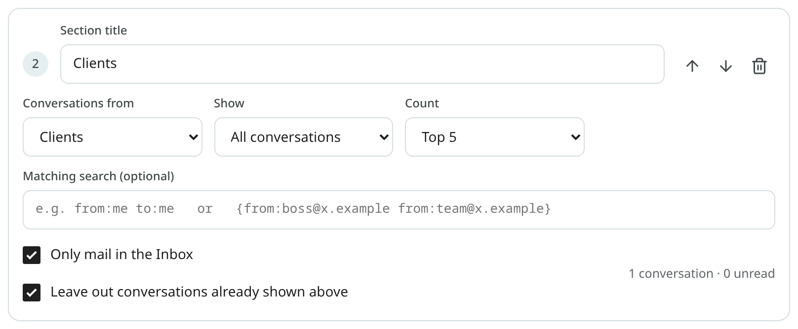

With the option off, the section shows every conversation with the label, archived or not. Turn
the option off for a tab you treat as a folder, such as a "Later" tab.

<!-- covers: layout.inbox_only -->

## Claiming tabs

The conversations of a tab with **Keep this tab's mail out of the other tabs** are shown in that
tab only, and they are left out of the other tabs' counts. The mail is not archived: it stays in
the Inbox for your phone's notifications, for IMAP apps and for every other view.

For example, notifications from a code host can be labelled by a filter and claimed by a "Code"
tab on that label.

When a conversation fits two claiming tabs, it is shown in the one further left. A store's
promotion with your Shopping label is shown in a Shopping tab placed before Promotions, and not in
Promotions. To move one conversation to the other tab, use **Show in tab** (below). To move all
such mail, reorder the tabs.

## Show a conversation in a tab

Right-click a conversation (or open the reader's ⋮ menu, or the toolbar's ⋯ menu with
conversations selected) and choose **Show in tab**. The submenu lists your layout's tabs in the
order of the tab bar. The tab where the conversation is shown now has a check mark. Choose another
tab to move the conversation there:

| Tab chosen | Result |
|---|---|
| A tab on a label | The conversation gets the label. Labels of claiming tabs with a prior claim on it are removed. |
| A tab on a category | The conversation gets the category. Labels of claiming tabs with a prior claim on it are removed. |
| The first tab | The labels of claiming tabs are removed. When the first tab lists one category (Primary in the Categories inbox type), the conversation gets it. |

A conversation in Archive is brought back to the Inbox when you pick a tab of the Inbox. With
**Undo**, the labels and the category are put back as they were.

Tabs built on a search or on a state (unread, starred, important) are greyed out: mail cannot be
put there with a label or category. Point at one, or tap it on a phone, to see why. With a layout of one tab, the menu has no
**Show in tab**.

**Show in tab** differs from **Move to folder**: With Move to folder, the conversation is taken out
of the Inbox; with Show in tab, it stays in the Inbox and only the tab it is shown in changes. To change only the
category, whatever your tabs are, use **More → Category** (see
[Categories](triage.md#categories)). In the command palette (`Ctrl + K`), type "show in tab" or
"category". On Android, the same choices are in the selection menu and the reader's menu.

Ambrose can do the same with its `show_in_tab` tool, naming the tab.
<!-- covers: mail.show_in_tab -->

## The Inbox count

<!-- covers: settings.inbox_count -->

The number by **Inbox** in the navigation is a count of unread conversations. Choose which ones
under **Settings → Mail → Inbox → Inbox count** (`inbox_count`):

| Choice | Counted mail |
|---|---|
| **Inbox tab only** (default) | Unread mail in the first tab of your layout: Primary in the Categories layout, the whole inbox list in a layout without tabs, and the first tab of your own layout. Mail claimed by another tab is not counted; that tab has its own number. |
| **All tabs** | Every unread conversation in your Inbox, in whichever tab. |

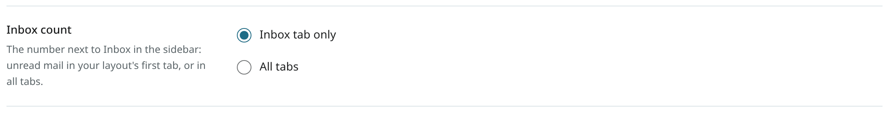

With **Inbox tab only**, the number by Inbox and the first tab's own unread indicator are the
same number. It is also shown in the browser tab's title and the Android app's drawer. In Desk
and Workspace, the folder pane's unread column is based on the setting, and its total column
still covers the whole Inbox.

The first tab is the counted one, whatever its name. In the layout editor it is marked **Counted in
the sidebar**, and it cannot be deleted. It can be renamed and its sections changed. To count another
tab, move that tab to the first place.

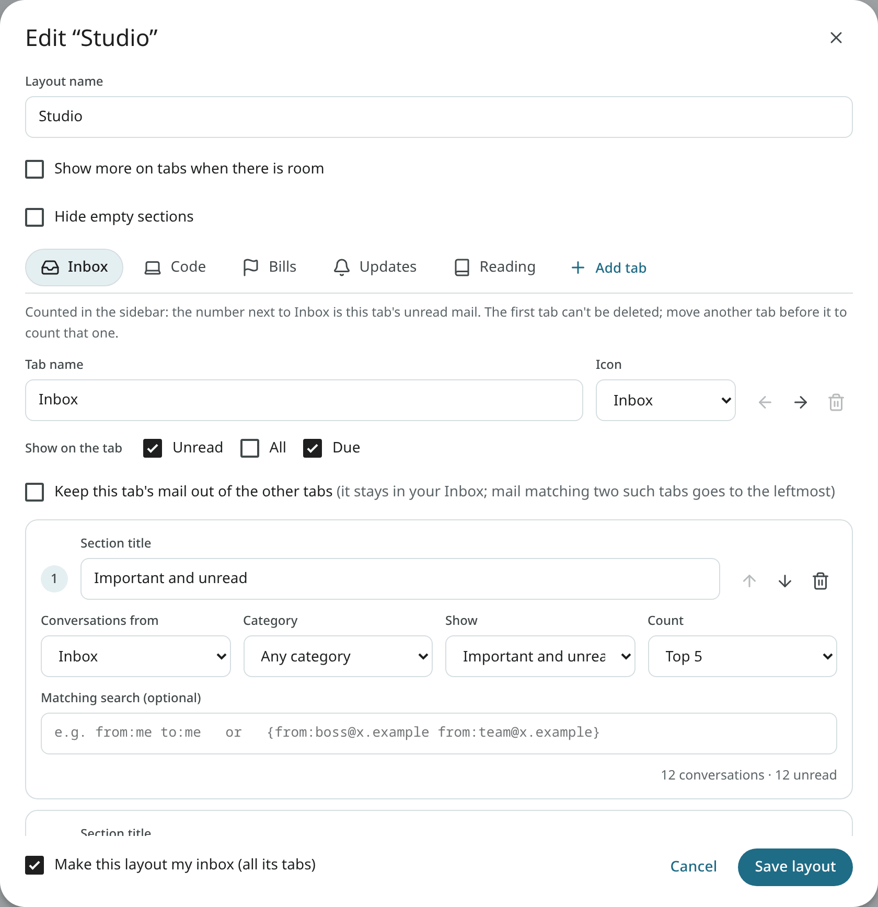

## Tab indicators

Each tab can have up to three indicators next to its name.

| Indicator | Meaning |
|---|---|
| **Unread** | "3 new": unread conversations in the tab. |
| **All** | "120": every conversation the tab lists. |
| **Due** | "Due Oct 4", "Due Oct 4 · 2" or "Overdue": the earliest deadline in the tab, in red when it is within two days or past. |

Hover the Due indicator (or long-press it on a phone) for the whole sentence, such as "2 due ·
earliest Fri 4 Oct (Riverbend Water)". A deadline you mark **Not a deadline** is no longer counted.
A passed deadline counts as Overdue for a week, then is dropped from the tab. The administrator can
change that window with `MAILR_OVERDUE_DAYS`.

How many indicators fit depends on the style: two pills in Classic, Cards, Workspace and Focus, one
compact indicator in Desk and at phone width.

### Hide empty sections

Turn on **Hide empty sections** in the layout editor to leave out a section while it has no
conversations, instead of showing its header with "No … conversations" under it. The section comes
back as soon as mail arrives in it. The tab's main section always shows, so an empty tab still says
so, and a section you chose to show alone shows even when it is empty. The phone app always leaves
out empty sections.
<!-- covers: layout.hide_empty -->

### Show more on tabs when there is room

Turn on **Show more on tabs when there is room** in the layout editor to show every indicator a
tab has while the tab strip has spare width: "3 new · Due Oct 4 · 12". When space runs out, a tab
goes back to its usual form. The tab strip never scrolls because of this setting. In the phone app,
the usual indicators stay.
<!-- covers: layout.tab_detail -->

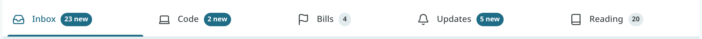

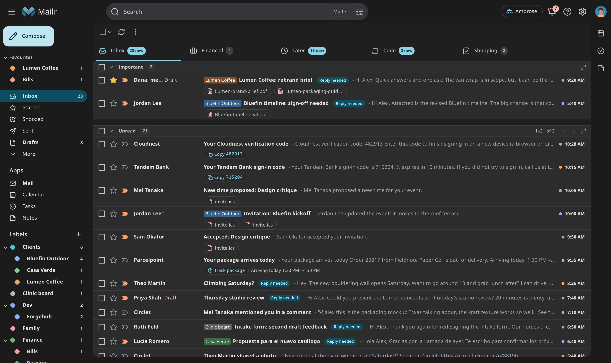

## Section actions

Every section header has a checkbox, **Select all in this section**, and actions that apply to
every conversation the section holds, not only the rows on screen:

- **Mark all as read** (or **Mark all as unread**), **Archive all** and **Delete all**;
- in the ⋯ menu: **Snooze all**, **Move all to**, **Label all**, **Mark all as important**, **Mark
  all as not important** and **Mute all**.

On a desktop the actions appear when you hover the header. On a touch screen they are always
shown as icons. Every section action has Undo. Press `* x` to select every conversation in the
focused row's section.

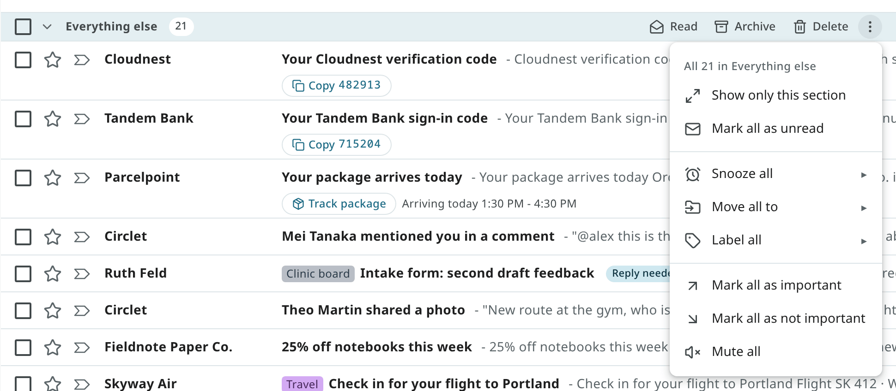

### Confirmation before section actions

A section action can change a lot of mail at once, so you are asked before each one runs: for the
header's buttons and for every entry of the ⋯ menu, in every style. The question shows:

- what happens, and to how many conversations (the server's count, for Mark all as read the unread
  ones);
- which section it applies to;
- how many of them are not loaded on screen (they are included).

The button shows the action and the count, for example **Archive 2**. It has the focus, so you can
press Enter to confirm. With Escape or **Cancel**, nothing is changed. **Delete** is shown in red.
After you confirm, the message at the bottom has Undo as before. Undo covers up to 10,000
conversations, and the question shows when a section holds more.

You are asked for **Mark all as read** in the list toolbar's ⋯ menu too. It applies only to the
conversations loaded on screen, as the question shows.

Actions on conversations you selected yourself, and on a single conversation, are done without asking.

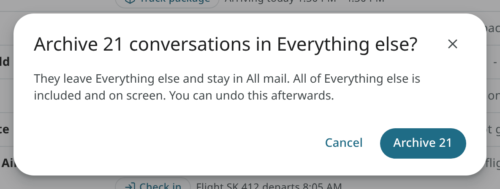

## Tabs in other styles

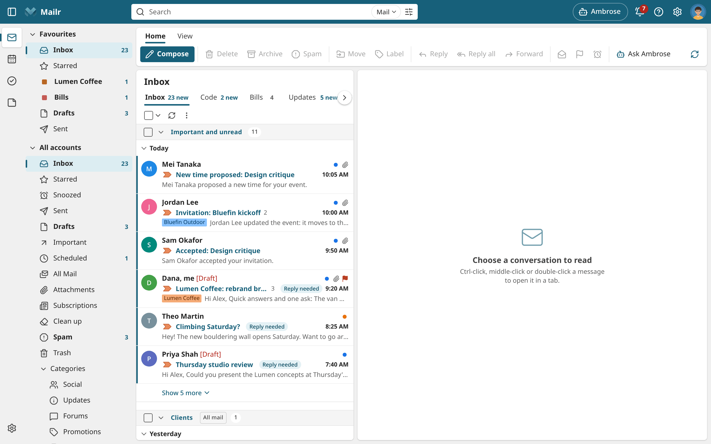
