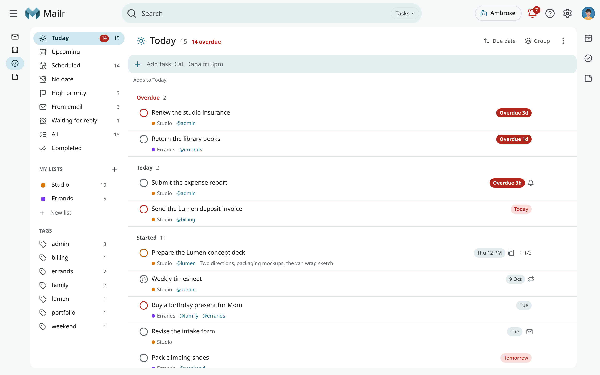
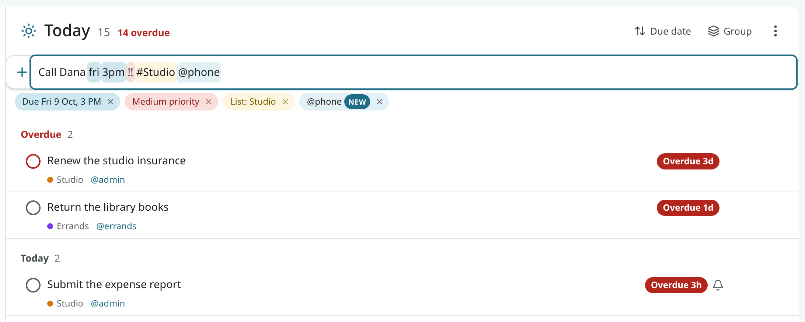
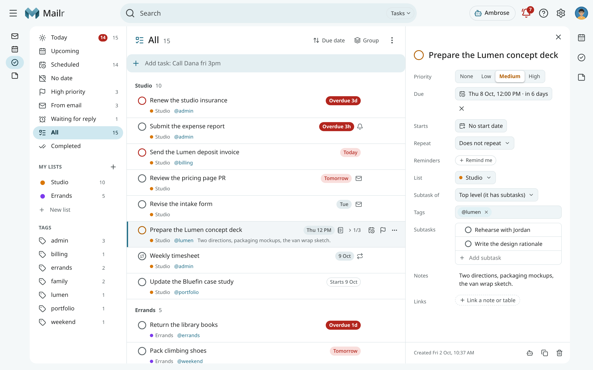
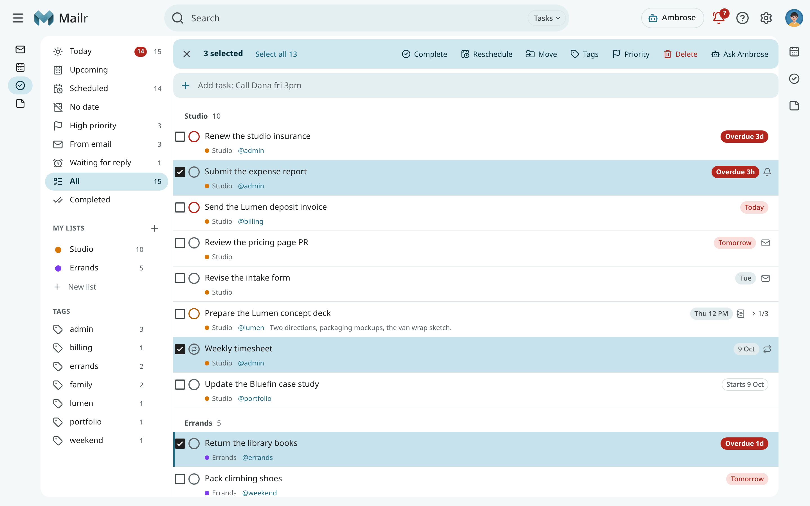
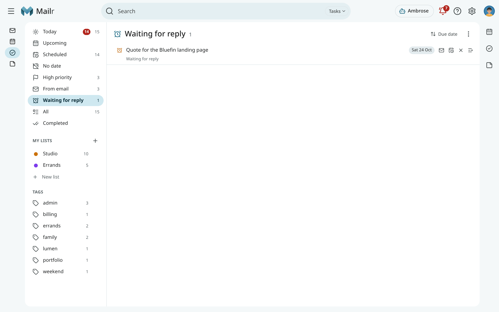
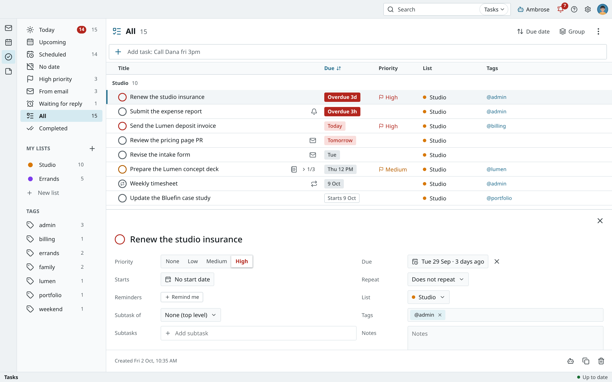
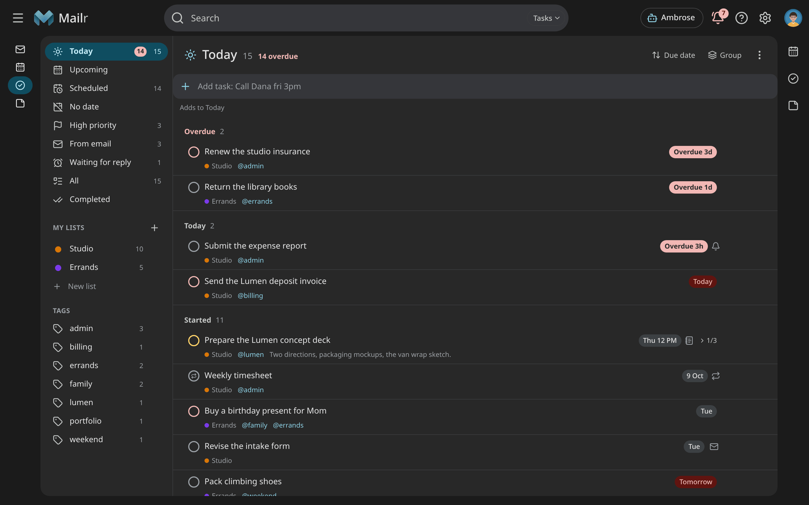
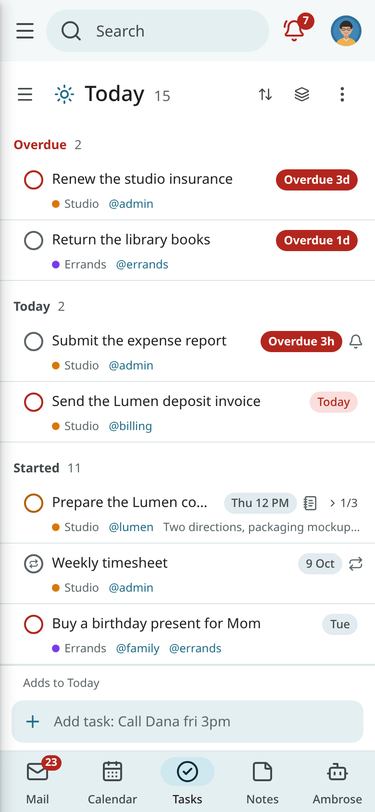

# Tasks

Tasks are kept in task lists on the CalDAV server, in the same account as the calendar, so the same tasks appear in any other app
connected to that server.



=== "Web"

    Click **Tasks** in the navigation, or press `g` then `k` from anywhere.

=== "Android"

    Tap **Tasks** in the bottom bar or the navigation rail. The drawer holds the smart lists, the
    lists and the tags.

Without a calendar, Tasks shows "No calendar connected yet" with **Connect a calendar**, which opens **Settings → Calendar & tasks** with the connect form. Under it, an admin sees "Built-in calendars are off…" with **Turn on built-in calendars**; a member sees "No calendar of your own yet? Ask whoever runs this Mailr server to turn on built-in calendars…". See
[Calendar](calendar-sharing.md#connect-a-calendar).

## Smart lists

Smart lists hold tasks from all lists. Their counts are updated live.

| Smart list | Contents |
|---|---|
| **Today** | Overdue tasks, tasks due today, and tasks that have started. It also shows follow-ups that are due. |
| **Upcoming** | Tasks due or starting in the next seven days, by day, then the rest of the month and later months. |
| **Scheduled** | Every task with a due date. |
| **No date** | Tasks with no due date and no start date. |
| **High priority** | Tasks marked High. |
| **From email** | Tasks made from an email. |
| **Waiting for reply** | Follow-up reminders on sent mail. |
| **All** | Every open task. |
| **Completed** | Done tasks, newest first. |

Under the smart lists come **My lists** and **Tags**. Click a tag to see every task that has
it.

## Add a task

The quick-add bar sits at the top of every list. On a phone it sits at the bottom, above the tab bar, with its chips above the line. Type a line and press Enter:

```text
Call Dana fri 3pm !! #Studio @phone
```

The date, the time, the priority (`!!` is Medium), the list and the tag are read and shown as
chips, and the rest is kept as the title. Press Enter to add the task; the bar is then ready for
the next one. When the list does not exist yet, you are asked first: **Create list** makes it, and **Add to Tasks** puts the task in your default list. Press Shift+Enter to add it and open its details. When several lines
are pasted, one task per line is offered. See [Quick add](quick-add.md) for the full grammar of the bar.
<!-- covers: task.create -->

The defaults come from the list in view: in **Today** a new task is due today, in a tag the
task gets that tag, and in a list it goes to that list. Otherwise it goes to the default list.

Tasks can also be added from other places:

- **Create from email → Task** on an email (see [Reading mail](reading.md#create-from-email)). The
  task has a link back to the email.
- **Create → Task** in the calendar, or the + in the Calendar and Tasks panels beside the page.
- **New task** in the command palette (Ctrl+K).
- The share sheet on Android: share text or a link to Mailr and choose **New task**.
- Ambrose: "Add a task to renew the studio insurance by Friday".



## Task details

Click a task to open its details pane. Every field is saved as you change it, and each change has
its own undo.



| Field | Description |
|---|---|
| Title | Click to edit. Press `e` or F2 to edit the title in the list. |
| Priority | None, Low, Medium or High. Keys `0` to `3`. The checkbox ring has the priority's colour. |
| Due | The date, with or without a time. |
| Starts | A start date. The task stays out of Today until then. |
| Repeat | A repeat rule, counted **From due date** or **From completion**. |
| Reminders | Reminders before the due time, or **At a time…**. |
| List | The list the task is in. |
| Tags | Any number of tags. |
| Subtasks | A checklist of smaller tasks. |
| Notes | Free text with light formatting. |
| Linked email | The email the task came from. |

<!-- covers: task.edit -->

### Complete and reopen

Click the checkbox, or press Space, to complete a task. It is struck through and an undo appears.
When you complete a parent, you are asked whether to complete its open subtasks too. On Android, swipe right.
<!-- covers: task.complete -->

Untick a completed task (in **Completed**, or with **Show completed** on) to reopen it.
<!-- covers: task.reopen -->

### Due dates and start dates

Use **Reschedule** (`r`) to change the due date. It has quick choices such as Tomorrow, Next week
and This weekend, and a date such as "fri 3p" can be typed. Drag a task onto a day in the
calendar, onto Today or Tomorrow in Upcoming, or onto a mini-month day to do the same. On Android,
swipe left. For a repeating task, you are asked whether the change is for this occurrence or all.
<!-- covers: task.reschedule -->

Use **Defer** (`s`) to set a start date. The task is hidden from Today and All until it starts, and
shown in Upcoming on that day. Turn on **Show deferred** in the header to see hidden tasks anyway.
<!-- covers: task.set_start -->

!!! note "Snooze and reschedule are different"
    With snooze, only a reminder that has gone off is moved; the task keeps its due date. With
    reschedule, the due date is moved. See [Snooze, follow-ups and reminders](snooze-and-reminders.md).

### Reminders

Use **Remind me** to add a reminder before the due time, or at a fixed moment with **At a time…**.
A reminder at a fixed moment keeps that moment, even days after the due date. Every reminder shows
as a chip with its time; the **×** on a chip removes it.
For a task with a time and no reminder, the reminder is at its due time; for a task with only a
date, at the morning hour. Both are set under **Settings → Calendar & tasks**
(`reminders.default_task`, `morning_hour`).
<!-- covers: task.remind_at -->

### Priority and tags

Set the priority with **Priority…**, the keys `0` to `3`, or `!!!`, `!!` and `!` in quick add.
<!-- covers: task.set_priority -->

Add tags with **Tags…** (`l`), by typing `@phone` in quick add, or by dragging a task onto a tag.
<!-- covers: task.tag -->

### Repeating tasks

Use **Repeat** to make a task come back: every day, every weekday, every other week, on the first
Monday of the month, and so on. With **From completion**, the next date is counted from the
completion, so "water the plants every 3 days" stays three days apart even after a late completion.
<!-- covers: task.set_repeat -->

When you complete a repeating task, it is moved to its next date and stays open. By default a
completed copy is kept each time, so the history is listed under **Completed**. These copies are
turned off under **Settings → Calendar & tasks**.

Use **Skip this occurrence** to move a repeating task to its next date without marking it done.
<!-- covers: task.skip -->

### Subtasks

Type in **Add subtask** in the details pane, or press Tab on an empty quick-add line right
after you add a task. Subtasks are shown indented under their parent with a count such as `2/5`.
<!-- covers: task.subtask_add -->

Press Tab on a task (or drag it to the right) to make it a subtask of the task above. Press
Shift+Tab (or choose **Make it a task again**) to bring it back to the top level. Subtasks go one
level deep.
<!-- covers: task.reparent -->

### Tasks from email

A task made from an email has an envelope icon and a chip with the email's subject. Click
**Open the email** to read it.
<!-- covers: task.open_email -->

Use **Reply** next to the linked email to open a reply to that message.
<!-- covers: task.reply_email -->

## Organise tasks

Use **Move to list** (`v`) to move a task to another list. Its subtasks are moved with it. You can also drag a task
onto a list in the left column.
<!-- covers: task.move_list -->

In a list sorted by **Manual** order, drag tasks up and down, or press Alt+↑ and Alt+↓. In the
details pane, drag a subtask onto another to change their order. After each move, you can put the
task back between its old neighbours with **Undo** in the message (or `z`); after Tab or Shift+Tab,
its old parent is restored too.
<!-- covers: task.reorder -->

Use **Duplicate** (Ctrl+D) to copy a task with its subtasks.
<!-- covers: task.duplicate -->

Use **Delete** (`#`) to remove a task and its subtasks after a short undo window.
<!-- covers: task.delete -->

The header has **Sort by** (Manual, Due, Priority, Title, Created), **Group by** (None, Due date,
Priority, List, Tag), **Show completed** and **Show deferred**.

## Select several tasks

Press `x` to select the focused task, Shift+click to select a range, Ctrl+click to add one, or
`*` then `a` to select all. On Android, long-press a task. A bar appears with actions for the
whole selection. With one undo, the whole batch is restored.

| Button | Effect |
|---|---|
| **Complete** | Complete every selected task. <!-- covers: task.bulk_complete --> |
| **Reschedule** | Set one due date, or shift each task with **Shift by +1 day** or **Shift by +1 week**, keeping their times. <!-- covers: task.bulk_reschedule --> |
| **Move** | Move them to a list. <!-- covers: task.bulk_move --> |
| **Tags** | Add or remove tags on all of them. <!-- covers: task.bulk_tag --> |
| **Priority** | Set one priority for all. <!-- covers: task.bulk_priority --> |
| **Delete** | Delete them all. <!-- covers: task.bulk_delete --> |

When some tasks could not be changed, for example because someone edited them elsewhere, a message
gives how many succeeded and which ones to check.



## Search tasks

Press `/` in Tasks to search titles, notes and tags in the search box at the top (its chip says
**Tasks**; see [Search](search.md#search-scope)). The list is narrowed as you type. Click **Clear
search** (×) in the box to end the search. Use these words to narrow it further:

| Word | Finds |
|---|---|
| `list:studio` | Tasks in the Studio list. |
| `tag:phone` or `@phone` | Tasks with that tag. |
| `due:<fri` | Tasks due before Friday. |
| `is:done` | Completed tasks. |
| `is:overdue` | Overdue tasks. |
| `has:email` | Tasks made from an email. |
| `pri:high` | High-priority tasks. |

<!-- covers: task.search -->

## Lists

With the [Mailr calendar](calendar-sharing.md#the-mailr-calendar), a list named **Tasks** exists from the start.
The calendar named **Calendar** next to it is for events and is not shown under **My lists**.

Use **New list** (the + next to **My lists**) to create a task list on your account, with a name and a
colour.
<!-- covers: list.create -->

Each list has a menu with these actions:

- Use **Rename** to change its name. You can also click the list's name in the header.
  <!-- covers: list.rename -->
- Use **Colour** to change its colour.
  <!-- covers: list.color -->
- Use **Default list** to make it the list new tasks go to when no other list is given. You can also
  set it under **Settings → Calendar & tasks → Default task list**.
  <!-- covers: list.set_default -->
- Use **Delete list…** to remove the list. You can first move its tasks to another list, or delete
  them too, and you are offered an `.ics` copy.
  <!-- covers: list.delete -->

Drag lists in the left column to change their order. On Android, use **Edit lists** in the
drawer.
<!-- covers: list.reorder -->

Use **Delete completed…** in the header menu to remove the completed tasks of a list for good.
Before deletion, the count is shown and an `.ics` copy is offered.
<!-- covers: task.clear_completed -->

## Tags

Each tag in the left column has a menu:

- Use **Rename** to change the tag on every task that has it.
  <!-- covers: tag.rename -->
- Use **Colour** to give the tag a colour.
  <!-- covers: tag.color -->
- Use **Delete tag** to remove it from every task.
  <!-- covers: tag.delete -->

## Waiting for reply

**Waiting for reply** lists the follow-ups set on sent mail: conversations with a reminder if
nobody answers. They are conversations, not tasks, so they are shown in grey. You
can open the conversation, change the date, cancel the follow-up, or choose **Make it a task**.
See [Snooze, follow-ups and reminders](snooze-and-reminders.md).



## Other styles and the phone







On Android, swipe right to complete and swipe left to reschedule. Both swipes are set in
the app's settings. Long-press a task to select several. See
[Calendar, tasks and reminders on Android](../android/calendar-and-reminders.md).
