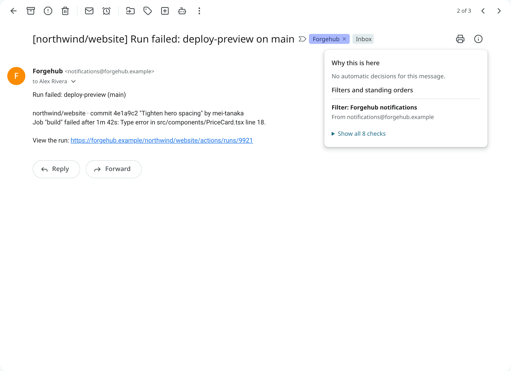
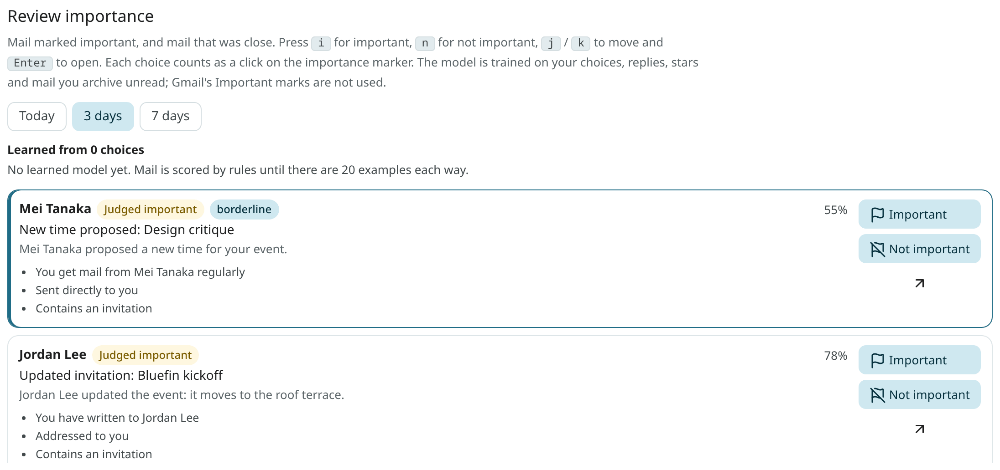
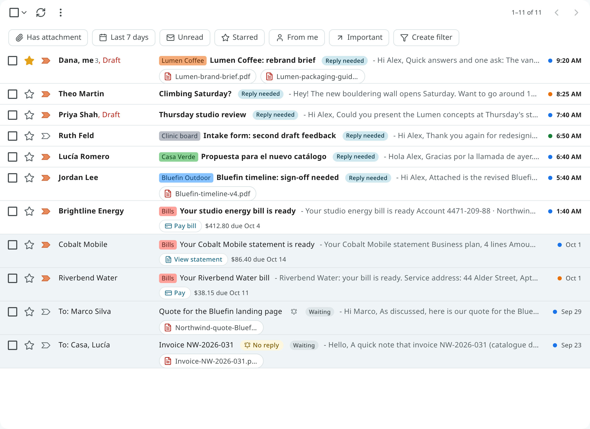
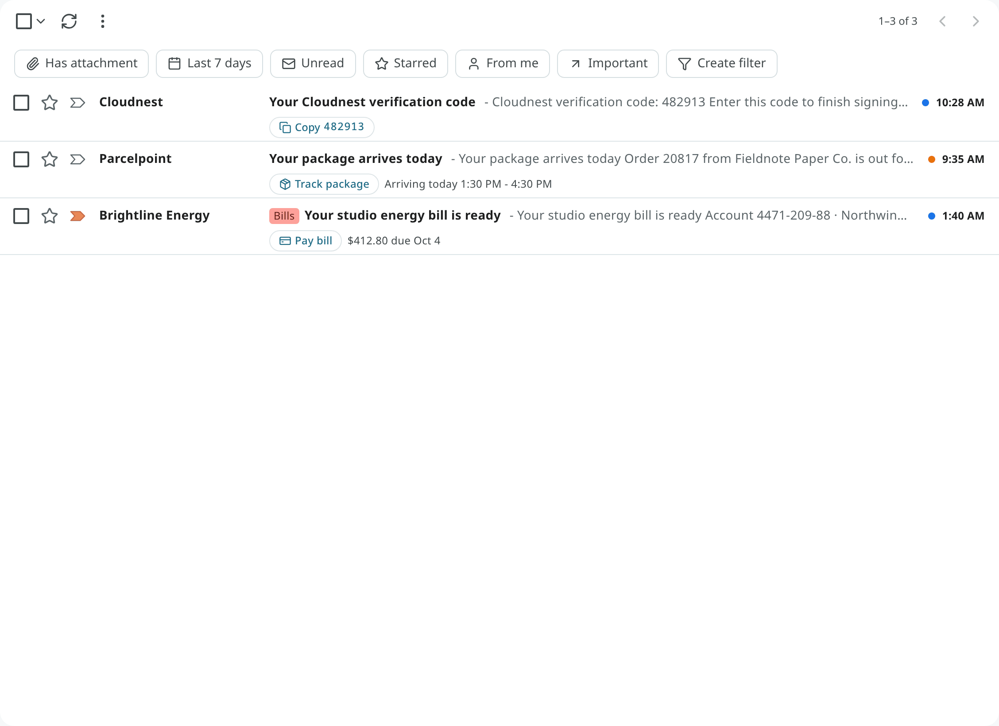
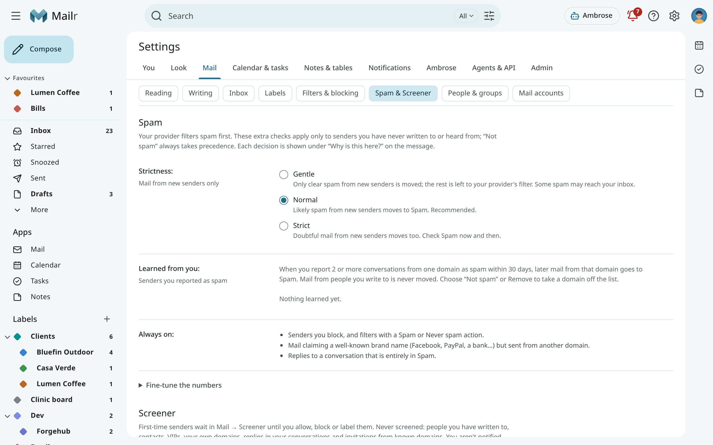

# Triage signals and importance

Each new message is classified once, on arrival: its category, its importance, whether it is
spam, and whether it requires an action from the user. Decisions made by the user take precedence:
a filter takes precedence over Mailr's guess, a correction takes precedence over a filter's earlier
verdict, and every correction is used for later decisions. Corrections are used to train only that user's
models.

Every decision on a conversation is listed under **Why this is here** in the reader, with its source
(a filter, a standing order, the rules, a model, or the user), its confidence and its reason. The
filters and standing orders that matched follow, in words; **Show all checks** lists them all with
their search terms.

## Categories

Each message is put in one category: **Primary**, **Promotions**, **Social**, **Updates**,
**Forums** or **Purchases**. With the Categories inbox type, categories become tabs; in custom layouts,
sections can be built on them.

To correct a category, right-click the row (or open the reader's ⋮ menu), choose **More →
Category**, and pick the right one. The current category is marked with a check. The change is
applied at once and learned from: after about ten corrections, the unsure cases are sorted by a model
trained for that user. With **Undo**, the old category is put back and the correction is withdrawn
from training.

A conversation is not always shown in its category's tab. In a custom layout, a promotion can be claimed by a tab on a
label before it reaches the Promotions tab, and a category that is not a tab of your layout is
shown in the first tab. To put a conversation in a particular tab, use **Show in tab** (see
[Show a conversation in a tab](tabs-and-layouts.md#show-a-conversation-in-a-tab)).
<!-- covers: mail.category -->

## Importance

Important mail has an importance marker. Each message is scored from what is known about it: whether you
write to the sender, whether you are in the conversation, whether the mail is addressed to you,
whether it is a mailing list. Once enough choices have been made, a model trained on them is added to
the score. It is trained only on your own actions: what you reply to, star or archive unread, and
the markers you click.

**Mark a conversation important** by clicking its marker, pressing `+` (or `=`), or choosing
**Mark as important** in the toolbar or menu. Press `-` for **Mark as not important**. Each click
is used for training. Hide the markers with **Importance markers** in Settings → Mail → Inbox
(`importance_markers`).
<!-- covers: mail.important -->

### Review importance

**Settings → Ambrose → Review importance** (or "Review importance" in the command palette) lists
the mail judged important, and the mail judged not important by a narrow margin, for Today, 3 days
or 7 days. Go through it with one key per row:

| Key | Choice |
|---|---|
| `i` | Important |
| `n` | Not important |
| `j` / `k` | Next or previous row |
| `Enter` | Open the email |

Each choice counts like a click on the marker, and the row is removed. The model is retrained within a
few minutes.
<!-- covers: mail.review_importance -->

### VIP senders

Mail from a VIP sender is always important, and a notification is sent at once. Add someone with **Make … a
VIP sender** in a message's menu, or under **VIP senders** in Settings → Mail → Inbox (`vip`). Search
for their mail with `is:vip`.

### Language model help

When the administrator has set up a language model, it is consulted on cases that are unclear
under the rules: an unclear category, a borderline importance, a deadline in the text. Bulk mail is
never sent to it, and mail from a local-only account is sent only to a local model. Use the
`llm_triage` setting to turn this help off for your account; only the rules and your trained models
are then used.

## Signals: Reply needed, Waiting and Due

Chips on the row and under the subject in the reader mark these states:

| Chip | Meaning | Search |
|---|---|---|
| **Reply needed** | Someone asked you something and waits for your answer. | `is:needs_reply` |
| **Waiting** | You asked, and you wait for someone else. | `is:waiting` |
| **Due Oct 4** | The mail holds a deadline for you: a bill, a form to return, a reply someone asked for by a date. It is shown in red when it is within two days or past. | `has:deadline` |

Only the user's own obligations count as deadlines. Sales that end, offers "valid through", newsletters'
event dates and points that expire do not count.

Mail in Spam or Trash has no chips, and it is not counted in the tab's Due indicator. Move it back
to the Inbox and its chips return.

### Not a deadline

When a deadline is wrong, click the Due chip (or right-click it, or long-press it on a
phone):

- use **Not a deadline** to remove this conversation's deadline;
- use **Not a deadline from this sender** to also stop deadlines from that sender from now on.

The chip is removed at once, the conversation is no longer counted in the tab's Due indicator, and
it no longer turns up for `has:deadline`.
<!-- covers: mail.dismiss_deadline -->

## One-tap actions

Delivery notices, bills, statements, sign-in codes and travel mail often have one main action. It
is shown as a chip on the row and at the top of the reader, often with the key fact:

| Chip | Example |
|---|---|
| **Track package** | "Arriving today 1:30–4:30 PM" |
| **Pay bill**, **View statement** | The amount and the due date |
| **Copy code** | A sign-in or verification code, copied with one click |
| **Check in**, **View order**, **Join meeting** | |

Click the chip to open the sender's link in a new tab, with the same safety as any link in mail.
The link is never visited by Mailr itself. Spam and suspicious mail get no chip.
<!-- covers: mail.primary_action -->

## Spam

New mail passes several checks before it reaches the Inbox: the provider's spam verdict, blocked
senders and filters, a check for senders who pretend to be a well-known brand, senders reported as
spam, and a spam classifier trained on the user's reports.

Use **Report spam** (`!`) to move a conversation to Spam and teach the classifier. In Spam, use
**Not spam** to move it back to the Inbox and teach the classifier the other way. Its labels are
restored with it. While the mail is in Spam, it is shown under no label, here or in other mail
apps connected to your mail. "Not spam" always
takes precedence over the automatic checks.
<!-- covers: mail.spam mail.not_spam -->

Adjust the checks in **Settings → Mail → Spam & Screener**. **Strictness** is one choice:

- **Gentle**: only clear spam from new senders is moved. The rest is left to your provider's verdict.
- **Normal** (the default): likely spam from new senders is moved to Spam.
- **Strict**: doubtful mail from new senders is moved too. Check Spam now and then.

The numbers behind each level are under **Fine-tune the numbers**:

| Setting | Description |
|---|---|
| **Spam classifier** (`spam_classifier`) | Off, Score only, or Score and move (the default). |
| **Classifier score threshold** (`spam_junk_score`) | The score at which mail goes to Spam (default 15). |
| **Provider score** (`spam_upstream_unknown_threshold`) | The provider's spam score at which mail from new senders goes to Spam (default 4; 0 for off). |
| **Likely spam** (`spam_suspect_score`) | Mail from new senders with a spam score at or above this (default 5; 0 for off) gets rules only: it is not read by any language model or decision model. |

The classifier and the provider score apply to new senders only: mail from people you write to is
never moved by a score.

Mail in Spam and mail from blocked senders is never sent to a model either. The **Why this is here**
panel then shows "Not checked by a model: likely spam". After **Not spam**, the message is
classified again by the user's models.

### Senders you reported

When you report mail from two or more conversations from the same domain as spam within 30 days,
later mail from that domain goes straight to Spam. At large mail providers such as gmail.com the
rule applies to the one address only. Mail from people you write to is never moved this way.

These domains and addresses are listed under **Settings → Mail → Spam & Screener → Learned from you**; use
**Remove** to take one off (`GET /api/v1/spam/domains`, `DELETE /api/v1/spam/domains/{key}`). You can
also take one off by marking mail from a listed domain **Not spam**.

