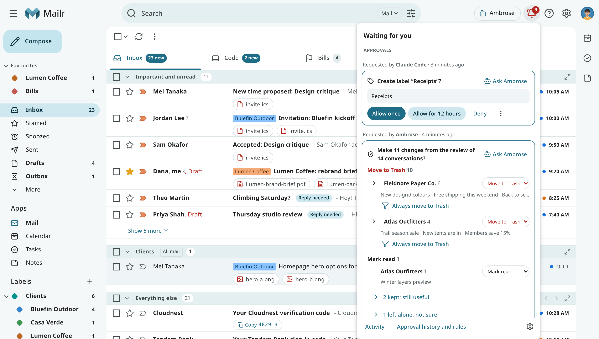

# Waiting for you

The bell at the top of every page holds the items waiting for attention. Its count is the sum of
pending approvals, messages that could not be sent, and reminders. The count is grey when only missed
reminders are left. The bell is in the same place in every layout, and on a phone too.

Click the bell to open **Waiting for you**. It has up to three sections, and only the ones with
something in them are shown:

| Section | Contents |
|---|---|
| **Approvals** | Actions Ambrose or an agent asks to take, each with its approval card. Decide them right there. |
| **Not sent** | Messages not accepted by the mail server, in plain words, each with **Retry**. Under **Open Outbox**, they are listed with **Edit** and **Discard**. |
| **Reminders** | Reminders that fired, then the **Missed** ones. Click one to open it. |

When nothing is waiting, the bell panel states that it is empty. Use the links at the bottom to open [Activity](activity.md)
(what changed recently, with Undo), your approval history and rules, and Settings → Notifications.

## Approvals

Each approval shows who asked and when, and the card with its choices. See
[Approvals](approvals.md) for what each choice does. When one chat or one agent has several
requests waiting, you can use **Allow all** to see them listed and allow each of them once. See
[Allow several at once](approvals.md#allow-several-at-once).

With an approval link from an agent or a push notification, the bell opens on that request.

## Not sent

A message that could not be sent is also marked **Not sent** in its conversation, and the **Outbox**
appears in the mail folders while something is queued or not sent. Use **Retry** to send it again. If
an address was refused, **Open Outbox** and choose **Edit** to fix it.

## Reminders

Use **Review all** to open the reminders one by one, and **Clear all** to dismiss them with one
**Undo**. See [Snooze, follow-ups and reminders](snooze-and-reminders.md#reminders-for-events-and-tasks).
