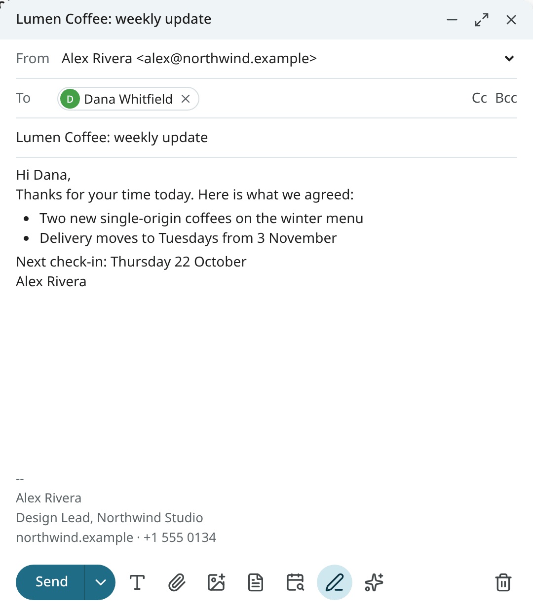
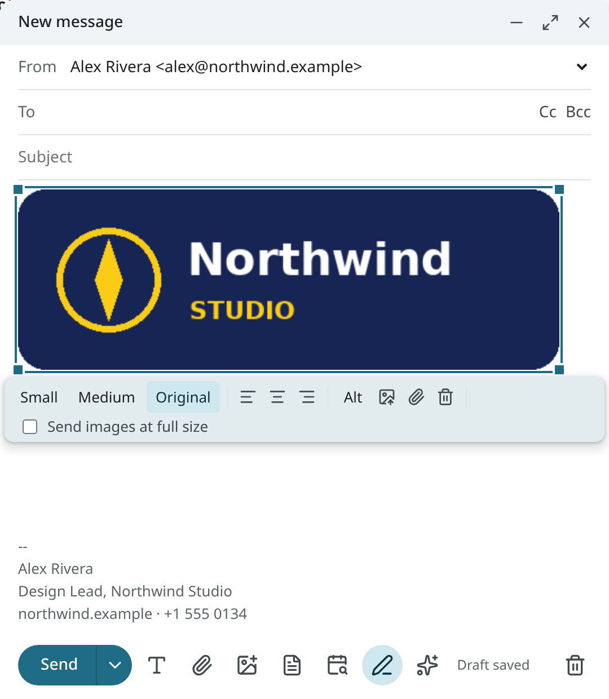
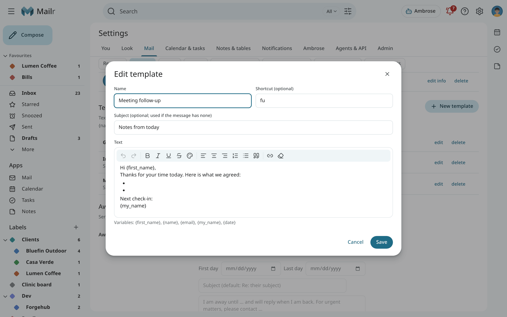
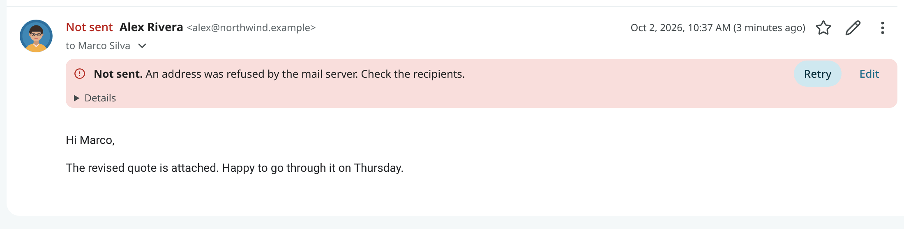
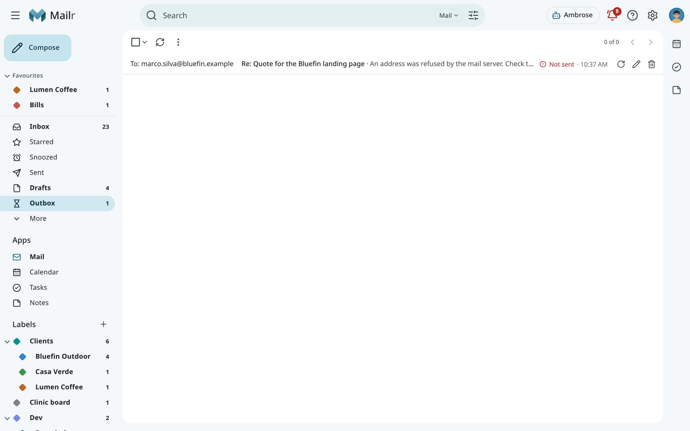
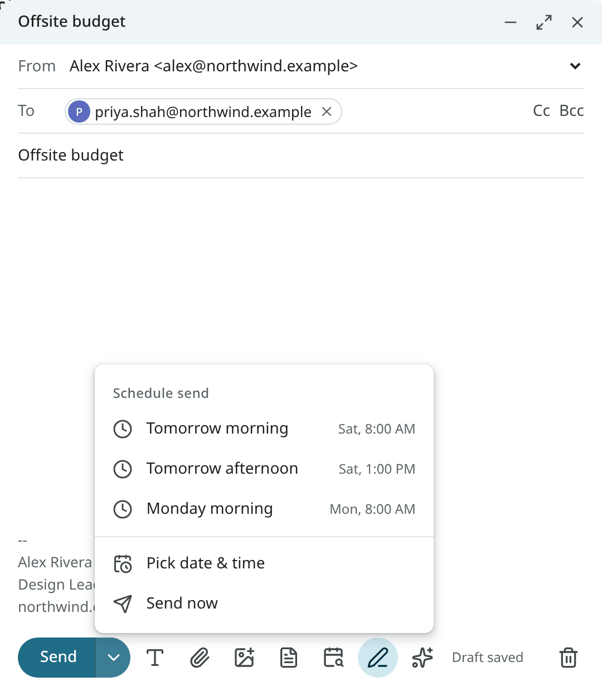

# Writing mail

Press `c`, or choose **Compose**, to write a new email. A compose window opens at the bottom right.
You can keep several open, minimise them, or switch one to full screen.

An email link (`mailto:`) opens a draft here too: in a message, in Ambrose's answers, on a person's
card. With **Settings → Mail → Writing → Email links**, the email links of other websites and
programs open a draft in Mailr as well. See [Make Mailr your email app](email-links.md).

## Reply and forward

In the reader, press `r` to reply, `a` to reply to everyone, or `f` to forward. The reply opens
under the conversation; use **Pop out reply** to move it into its own window. Whether Reply or
Reply all is the main button is set under **Default reply** in Settings → Mail → Writing
(`default_reply`).

A forward includes the original message and its attachments, and its inline images. It stays in the
original's conversation, as a reply does, so the email and what you forwarded show together.
<!-- covers: mail.reply mail.forward -->

The line above the quoted message ("On Mon 19 Oct 2026, 8:30 PM, Lena Hart wrote:") and the
forwarded message's header are in your language, with the time in your time zone and clock
(Settings → You → Region).

When the conversation already has a draft, yours or one Ambrose wrote, that draft is opened when you
choose **Reply**, **Reply all** or **Forward**. The notice has **Start a new reply** when you want a
second one. If Ambrose's draft was waiting for approval, the request is withdrawn when the draft is opened
for editing; the draft is then sent only when you send it.
<!-- covers: draft.resume -->

## Recipients and the From address

Type a name or address in To, Cc or Bcc. The people you write to most are suggested. Type a
group's name to address every member at once (see [People & groups](people.md)).
Suggestions whose first name, last name or address starts with what you typed come first.
An address still typed when you click **Send** or press `Ctrl + Enter` goes with the message.
If an entry is not an email address, or there is no recipient, the message is not sent: a note
under the address fields names the entry and its field ("in Cc"), and the focus moves to it so you
can fix it. The note goes away when you change the recipients.

**From** lists every address you can send as. Each account has its own addresses, and each
address has its own signature, set in **Settings → Mail → Writing → Send mail as**. A reply is sent from the address
the mail was sent to.

## Formatting and signatures

Use **Formatting options** to show the toolbar: bold, italic, underline, lists, quotes, text colour,
links (`Ctrl + K`) and **Remove formatting**.

The signature is added automatically. Use **Insert signature** and **Remove signature** to switch
it for this message. In replies, it goes below or above the quoted text, as set by **Signature
placement** in Settings → Mail → Writing (`signature_placement`).

## Images in the message

Put a picture in the text with **Insert image**, by pasting it, or by dropping an image file onto
the text. Files dropped anywhere else, or picked with the paperclip, become attachments.

- PNG, JPEG, GIF and WebP go into the text, up to 10 MB each. An SVG can only be attached.
- Large photos are reduced to 2560 pixels on the longer side before upload. Use **Send images at full
  size** to keep the originals for this message.
- Click an image to resize it (Small, Medium, Original, or drag a corner), align it, add **Alt
  text**, replace it, or turn it into an attachment.

The message cannot be sent until every image has finished uploading.
<!-- covers: mail.insert_image -->

## Attachments

Choose **Attach files**, or drop files onto the compose window. Files up to 25 MB each are
accepted. The attachments of all your drafts and unsent mail together may take 1 GB, or another
amount set by the administrator; attachments that no draft uses any more are removed to make room.
If the text mentions an attachment ("attached", "enclosed") and nothing is attached,
confirmation is requested before the message is sent.

## Templates

Templates are saved texts for insertion into any message, such as a thank-you, meeting notes or
an invoice reminder.

**Create one** in **Settings → Mail → Writing → Templates → New template**. Give it a **Name**, an optional
**Shortcut** (letters, digits, `-` and `_`), an optional **Subject**, and the text. Edit or delete
a template from the same list.
<!-- covers: template.create template.edit template.delete -->

**Insert one** while you write:

- type `;` and the shortcut at the start of a line or after a space, then press Space or Tab:
  `;thx` becomes the "Got it, thanks" template;
- or choose **Templates** in the compose toolbar and pick one.

The template's subject is used only when the message has none. These variables are filled
in when you insert the template:

| Variable | Value |
|---|---|
| `{first_name}` | The first recipient's given name. |
| `{name}` | The first recipient's full name. |
| `{email}` | The first recipient's address. |
| `{my_name}` | The name of the address you send from. |
| `{date}` | Today's date, such as "October 2, 2026". |

A variable without a value (no recipient yet) stays as typed, so the gap is visible.
<!-- covers: template.insert -->

## Help me write

Use **Help me write** in the compose toolbar to draft or edit the message from a short instruction: "accept,
propose Tuesday 2pm", or "shorter". Type `/` for your writing skills. Ambrose changes the
draft in place, and the change can be undone. See [Ask Ambrose](assistant.md).

To offer free times in a reply, use **Insert times** in the compose toolbar. See [Suggest times in a reply](invitations.md#suggest-times-in-a-reply).

## Drafts

The draft is saved as you type. Use **Save & close** to close the window and keep the draft in
Drafts; open it from there to continue. The draft is a real message in the Drafts folder, so it
also appears on the phone and in IMAP apps.
<!-- covers: draft.save -->

When the server cannot be reached, the status line shows **Draft not saved**, and the text is kept
on this device until a save goes through. If you close or reload the tab before then, you are
asked first. After a reload, a crash or a sign-out, the window is opened again with the note
**Restored unsent draft**, and the draft is saved to the server as soon as possible. Once it is
saved, the copy in Drafts is the current version.

Use **Discard draft** (the trash button) to delete it. The notice has Undo.
<!-- covers: draft.discard -->

## Send, and undo send

Choose **Send** or press `Ctrl + Enter`. The notice shows **Sending…** with **Undo** while the undo
window lasts; with Undo, the message is brought back into a compose window. **Message sent** is
shown only once the message has left. Set the window under **Undo send** in Settings → Mail → Writing
(`undo_send_seconds`, 10 seconds by default).

Until it has left, the message in the conversation is marked **Sending**, then **Sent** for a
moment. If it is not accepted by the mail server, the message is marked **Not sent**, with the reason in
plain words, **Retry** and **Edit**. The server's own message is under **Details**, and a notification is
also sent.
<!-- covers: draft.retry_send -->

Sometimes the connection to the mail server drops after the whole message was handed over, before the
server confirmed it. The message may then have gone out, so it is never sent again on its own. It is
marked **May have been sent**. If your provider keeps its own copy of sent mail (Gmail and Microsoft
do), the provider's Sent folder is checked for it over the next ten minutes, and it is marked **Sent**
once it is found there. Otherwise, check the Sent folder at your provider, then choose **Retry** to
send it again or **Discard** to remove it from the Outbox.

While a message is on its way or was not sent, **Outbox** appears in the mail list of folders. Those
messages are listed there with **Retry**, **Edit** and **Discard**, and the Outbox is removed again
when nothing is left in it.
<!-- covers: draft.outbox -->

Turn on **Send and Archive** (`send_and_archive`) to add a button for sending the reply and
archiving the conversation in one step.
<!-- covers: draft.send -->

!!! note "Mail sent by Ambrose"
    Mail sent by Ambrose or by an agent requires approval before it is sent. See
    [Approvals](approvals.md).

## Schedule send

Open **More send options** (the arrow next to Send) and choose **Schedule send**: a preset such as
Tomorrow morning, Tomorrow afternoon or Monday morning, or **Pick date & time**. The message waits
in **Scheduled** until then. Open it there to send it now, or cancel the send to turn it back into
a draft.
<!-- covers: draft.schedule -->

## Away message (out of office) { #away-message }

Use **Away message** in Settings → Mail → Writing to send an automatic reply while you are away: an out-of-office or vacation reply. Set the
first and the optional last day, a subject and the text. Use **Only send to people I have written
to** to limit it to your contacts. It is sent once every 4 days to each person who writes, and never to
mailing lists, automated mail or no-reply senders (`vacation`).

The reply is sent only to senders whose address is confirmed by their mail server. Mail in Spam or Trash,
mail from blocked senders and mail that looks like spam gets no reply. The reply's subject is the
one set here, or "Away message" when the field is empty; the sender's subject is never repeated. At
most 30 automatic replies are sent in an hour.
